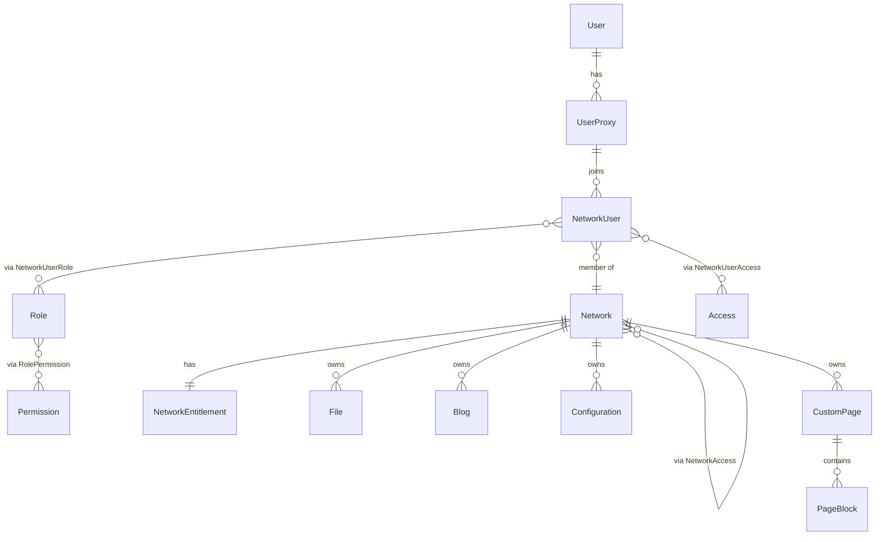

# ThirdPartyNetwork — Database, Permissions & Entitlements Overview

Generated from a source read of the codebase on 2026-08-12. This is a snapshot, not a
living spec — re-verify against the code before relying on specifics (file/line
references are given throughout so this is easy to do).

Stack: ASP.NET Core (.NET), EF Core with **Npgsql (PostgreSQL)**, JWT bearer auth,
AutoMapper, Cloudinary for file storage.

---

## 1. Domain model at a glance

The app is a **multi-tenant identity/SSO provider**. A single physical person (`User`)
can have multiple `UserProxy` "personas" (think: different display name/avatar/email per
context). Each `UserProxy` can join multiple `Network`s (tenants), and per network gets a
`NetworkUser` membership row that carries roles, ad-hoc permission-scope grants, and
usage-entitlement overrides. Networks also own their own user-generated content (files,
blogs, custom pages, config).



### 1.1 Identity

| Entity | Purpose | Key fields |
|---|---|---|
| `User` | The one durable "real person" record. Has no profile fields itself. | `Id` (Guid) |
| `UserProxy` | A persona of a `User`; carries all profile data. `IsDefault` marks the fallback persona whose fields backfill the others (`ApplyDefaults()`). | `Username`, `FirstName`, `LastName`, `Email`, `Password` (hashed), `ImageFileId`, `IsDefault`, `UserId` |

Note: none of `Username`, `Email` have a unique DB constraint (see §6.5).

### 1.2 Tenancy

| Entity | Purpose | Key fields |
|---|---|---|
| `Network` | A tenant / third-party client. One network, `"TrojoNetworks"` (`Constants.Networks.Main`), is the **main/super network** — see §3.3. | `Name`, `IsPublic`, `Description`, `RedirectURI`, `ImageFileId`, `IsSystemProtected` |
| `NetworkUser` | Membership: one `UserProxy` inside one `Network`. Carries a JSON `Entitlements` override blob and `AccessIncomplete` flag. | `NetworkId`, `UserProxyId`, `Entitlements` (jsonb), `AccessIncomplete` |
| `NetworkEntitlement` | 1:1 with `Network` (PK = `NetworkId`). Quota/feature-flag config — see §4. | `AllowFiles`, `FileCountLimit`, `FileSizeLimit`, `FileStorageLimit`, `AllowBlogs`, `BlogCountLimit`, `AllowConfigurations`, `ConfigurationCountLimit`, `AllowCustomPages`, `CustomPageCountLimit`, `CustomPageBlockCountLimit`, `CustomPageBlockSizeLimit` |

### 1.3 RBAC (roles/permissions)

| Entity | Purpose |
|---|---|
| `Permission` | An action right, e.g. `"Read Network"`, `"Manage User"`, `"Administrator"`. Global by default; `NetworkId` (nullable FK, added in the `NetworkCreatePermission` migration) lets a permission be scoped to one network — networks created via the API get such network-scoped permission rows. |
| `Role` | Named bundle of permissions, always scoped to one `Network` (`NetworkId`). Also carries its own JSON `Entitlements` override blob (see §4). `IsDefault` marks the role auto-assigned to new members. |
| `RolePermission` | N:N join, composite PK `(RoleId, PermissionId)`. |
| `NetworkUserRole` | N:N join assigning `Role`s to a `NetworkUser`, composite PK `(NetworkUserId, RoleId)`. |

### 1.4 Access ("consent scopes")

This is a **separate system from RBAC** — it models OAuth-style consent for which profile
fields a network is allowed to see, not what a user is allowed to *do*.

| Entity | Purpose |
|---|---|
| `Access` | A requestable profile claim, e.g. `"Access Username"`, `"Access Email"`, `"Access ProfilePicture"` (seeded set, see §7). |
| `NetworkAccess` | Which `Access` items a `Network` wants, and whether `IsRequired`. Composite PK `(NetworkId, AccessId)`. |
| `NetworkUserAccess` | Per-member consent state: `IsAccepted`. Composite PK `(NetworkUserId, AccessId)`. |

`NetworkUser.AccessIncomplete` is set when a member hasn't yet accepted all of a
network's *required* `NetworkAccess` grants; this is mirrored into the JWT as an
`AccessIncomplete: true` claim and enforced by `PermissionHandler.PreChecks()` (§3.5).

### 1.5 User-generated content

All content types derive from `UserContentBaseModel` (itself derived from `BaseModel`):

```csharp
AuthorId (→ NetworkUser), NetworkId (→ Network), AccessLevel (enum, default Private)
```

| Entity | Notes |
|---|---|
| `File` | Cloudinary-backed asset. `PublicId`, `Url`, `Format`, `SizeBytes`, `Width/Height`, `Duration`, `MediaType`, `IsSystemProtected`. |
| `Blog` | `Title`, `Slug`, `Summary`, `Body` (jsonb), optional `CoverImage`, `PublishedAt`. |
| `Configuration` | Arbitrary `Key` → `Value` (jsonb) per network. |
| `CustomPage` | `Name`, `Slug`, has many `PageBlock`s (cascade delete). |
| `PageBlock` | Belongs to one `CustomPage`; `Text`, `Position`, `Data` (jsonb), optional `ParentPageId` (self-referencing, nullable — no FK constraint modeled for it in `DataContext`, only a plain column). |

`AccessLevel` enum (`Core/Enum/AccessLevel.cs`):
```
Private = 0            // only the author (or someone with the resource's Manage/Read permission)
PublicToNetwork = 1     // any member of the same Network
Public = 2              // anyone, including anonymous
```

### 1.6 Not persisted to the database

- `AuthorizationCode` — OAuth-style authorization codes for the external login/PKCE flow.
  Explicitly commented `// NOT stored in database, but in memory` and held in a
  process-local static `AuthorizationCodeStore` (`Core/Stores/AuthorizationCodeStore.cs`).
  See §6.4 for why this matters.

### 1.7 Schema mechanics worth knowing

- `BaseModel` gives every entity `CreatedOn` (default `DateTime.UtcNow` at construction)
  and `UpdatedAt`. `UpdatedAt` is **not** auto-maintained by EF/DataContext — it's only
  bumped by two opt-in helper methods on `BaseRepository`
  (`SaveAndUpdateAsync`/`SaveAndUpdateAllAsync`). Repository code paths that call
  `context.SaveChangesAsync()` directly leave it at `default(DateTime)`.
- jsonb columns: `PageBlock.Data`, `Configuration.Value`, `Blog.Body`,
  `Role.Entitlements`, `NetworkUser.Entitlements` (the latter two default to SQL `'{}'`).
  Under the EF InMemory provider (used in tests) these are stored as plain strings via a
  manual `HasConversion`, so JSON-shape bugs can hide in unit tests and only appear
  against real Postgres.
- Cascade deletes: `Network → CustomPage/PageBlock/Configuration/Blog/File/NetworkEntitlement/Role`
  all cascade. `UserContent.AuthorId → NetworkUser` also cascades (deleting a membership
  row deletes everything that member authored). `ImageFileId`/`CoverImageId` use
  `SetNull` instead.
- **No unique indexes exist anywhere except primary keys** — confirmed against
  `DataContextModelSnapshot.cs`. Not on `UserProxy.Username`, `UserProxy.Email`,
  `Network.Name`, `Permission.Name`, `Access.Name`, `Blog.Slug`, or `CustomPage.Slug`.
  Uniqueness for these is enforced only in application code, and only for some of them
  — see §6.5.

---

## 2. Authentication

- JWT bearer tokens, HMAC-SHA256, signed with `TOKEN_SECRET` env var
  (`Application/Auth/TokenGenerator.cs`).
- **Access token**: 15 min lifetime, claims: `jti`, `name` (username), `uid`
  (UserProxy id), optional `AccessIncomplete: true`.
- **Refresh token**: 3 days, claims: `jti`, `uid`. Refresh-token rotation with reuse
  detection via `JtiCacheService` — each refresh links `jti → previousJti` as a tree; if
  a `jti` is reused after already producing a child, the whole lineage is invalidated
  (`AppendValidateJti` / `RemoveTrackerTree`). This is a solid rotation-detection design.
- Tokens carry a **dynamic `aud` (audience)** claim scoped to the network's
  `RedirectURI` host, so the same account can hold tokens meant for different
  third-party network client apps. Validity of `aud` is checked against
  `IDynamicAudienceCache`, which is reloaded from all networks' `RedirectURI`s
  whenever a network is created/updated/deleted (`NetworkService.RefreshIssuerCacheAsync`)
  plus once at app startup (`Program.cs`).
- Main-network (first-party) login/refresh is separate from the **external OAuth-ish
  flow** used by third-party networks: `POST /auth/{networkId}/login` issues a
  short-lived `AuthorizationCode` (PKCE `codeChallenge` + `clientId` bound), which is
  redeemed via `POST /auth/token` with a `codeVerifier` (`PKCEVerifier`, standard
  S256 PKCE) to get the actual token pair.
- Password hashing via injected `IPasswordHasher` (not read in detail here, but used
  consistently for verify/hash).

---

## 3. Permissions (RBAC) — how a request gets authorized

### 3.1 Permission catalog (`Core/Constants.cs`)

Buckets that change how `PermissionHandler` evaluates a permission name:

- `Administrator` — wildcard: if a role that a user holds in the relevant network (or
  the main network) grants `Administrator`, every permission check on that
  network/main-network scope passes.
- `SystemManaged` — special sentinel meaning "no one calls this through the ordinary
  permission path" (see §3.4 — it's a deliberate hard stop, not a normal permission).
- `GeneralPermissions` (`ReadAccess`, `ReadPermission`) — checked against *any* network
  the caller belongs to, not just the one in the URL.
- `ContentPermissions` (`ReadCustomPage`, `ReadPageBlock`, `ReadFile`,
  `ReadConfiguration`, `ReadBlog`) — resolved via the resource's own `AccessLevel`
  (§3.6), not just role membership. `ReadBlog` is also in `SlugContentPermissions`
  since blogs can be addressed by slug instead of id.
- `OwnerPermissions` (`IsUserOwner`, `IsNetworkUserOwner`, `IsUserProxyOwner`) —
  resolved by ownership checks in `IdentityVerifier`, independent of roles entirely.
- Everything else (`ReadNetwork`, `ManageNetwork`, `ReadRole`, `ManageRole`, `ReadUser`,
  `ManageUser`, etc.) goes through the default role-based path.

### 3.2 Wiring: attribute → policy → handler

- Controllers/actions are decorated `[RequirePermission(Constants.Permissions.X, ...)]`
  (`Requirements/RequirePermissionAttribute.cs`), which is just an `AuthorizeAttribute`
  whose `Policy` string is `"Permission:" + string.Join(",", permissions)`.
- `DynamicPermissionPolicyProvider` (registered as the app's
  `IAuthorizationPolicyProvider`) recognizes the `"Permission:"` prefix, splits the CSV
  back into a `string[]`, and builds a policy with one `PermissionRequirement`.
- `PermissionHandler.HandleRequirementAsync` iterates the requirement's permission list
  and **succeeds if any single one passes** — i.e. multiple permissions listed on one
  attribute are OR'd together (e.g. `[RequirePermission(ReadUser, IsUserOwner)]` passes
  for either a role-holder of `ReadUser` **or** the resource owner).
- If **multiple `[RequirePermission]` attributes** are stacked on one action (e.g.
  `RolePermissionController.GetRolePermissions` has two separate attributes for
  `ReadRole` and `ReadPermission`), ASP.NET AND's the *requirements themselves*
  together — so stacking attributes is effectively AND, listing several permissions
  inside **one** attribute is OR. Easy to misread when skimming controllers.

### 3.3 Evaluation order inside `PermissionHandler.CheckPermissionAsync`

1. **Unauthenticated caller** → passes only if the permission is in `ContentPermissions`
   *and* the target resource's `AccessLevel` allows anonymous access (`Public`).
2. **Owner permissions** → delegate straight to `IdentityVerifier.Is*OwnerAsync` (§3.5).
3. **Content permissions** → resolve the specific resource id from the route (e.g.
   `fileId`, `customPageId`, `configurationId`, `pageBlockId`, or `slug` for blogs) and
   run `AccessLevelVerifier` (§3.6). If the route has *no* id (a list endpoint), this
   step passes unconditionally and defers filtering to the repository/service layer.
4. **General permissions** → checked against every network the caller belongs to, not
   just the URL's network.
5. **Default** → `IsSuperAdminOrHasSuperPermissionAsync` (main network) **or**
   `IsNetworkAdminOrHasPermissionAsync` for the `networkId` extracted from the route.

### 3.4 The `Administrator` wildcard and the main network

`IdentityVerifier.CheckQueryableAsync` treats holding a role with the `Administrator`
permission as passing *any* permission check for that network scope. `IsAllowedAsync`
checks **both** the main network (`"TrojoNetworks"`) and the target network — so an
Administrator role in the main network is effectively a **global super-admin**, while an
Administrator role scoped to network X only grants admin rights inside X.

`Constants.Permissions.SystemManaged`: in `PermissionHandler.HandleRequirementAsync`,
the loop does:
```csharp
if (permission == Constants.Permissions.SystemManaged) { break; }
```
i.e. hitting this sentinel **stops evaluation without calling `context.Succeed`**,
guaranteeing a deny for the whole requirement — even if other permissions listed
alongside it (checked *before* it in array order) haven't been evaluated yet, or would
otherwise have passed. In practice it's used as "this endpoint has no legitimate
caller through the public API" (e.g. `PermissionController.CreatePermission`), but
because evaluation order matters and it's just a positional string in a params array,
it's a footgun for future edits — see §6.9.

### 3.5 Owner permissions (`IdentityVerifier`) — ⚠️ see §6.2, broken for two of three

- `IsNetworkUserOwnerAsync(userProxyId, targetNetworkUserId)` — **correctly implemented**:
  resolves whether `targetNetworkUserId` belongs to any `UserProxy` under the *same*
  `User` as the caller's `userProxyId`.
- `IsUserOwnerAsync(userProxyId, targetUserId)` and
  `IsUserProxyOwnerAsync(userProxyId, targetUserProxyId)` — **do not filter by the
  caller's identity at all**. See §6.2 for the concrete impact; this is the second most
  important finding in this document.

### 3.6 Content `AccessLevel` resolution (`AccessLevelVerifier`)

For a single resource (`CheckAccessAsync`): `Public` → always allowed; otherwise
requires authentication, then: permission override (`IsAllowedAsync` for that
network **or** main network) → else `Private` requires `AuthorId == caller` → else
`PublicToNetwork` requires caller to be a member of that resource's network.

For **listing** resources, the same rules are hand-re-implemented as an
`Expression<Func<T,bool>>` in `GetAccessPredicateAsync` so EF can translate it to SQL
(can't run arbitrary C# in a LINQ-to-SQL query). See §6.8 — this duplication is a
maintenance risk.

### 3.7 The "AccessIncomplete" hard gate

`PermissionHandler.PreChecks()` runs before any permission logic: if the caller's JWT
carries `AccessIncomplete: true`, every request is rejected with
`ACCESS_INCOMPLETE` **except** the one specific route matching
`PUT /networks/{networkId}/users/{networkUserId}/accesses/{accessId}` (i.e. accepting/
declining a required access grant) — plus `/me`, which never goes through
`PermissionHandler` at all because it has no `[RequirePermission]`. This is how a
network can force a member to consent to required `Access` scopes before doing
anything else on that network.

---

## 4. Entitlements — usage quotas / feature flags

Distinct from both RBAC and Access-consent: entitlements answer "how much of feature X
can this user/network still use", not "is this action allowed" or "can this network see
my email".

Three layers, resolved by `EntitlementService`:

1. **Main network's `NetworkEntitlement`** acts as a **global hard ceiling**. Any
   feature disabled on the main network (`AllowFiles`, `AllowBlogs`, etc.) is disabled
   everywhere, full stop (checked first in every `CheckUserAdd*EntitlementAsync`
   method).
2. **Per-`Network` `NetworkEntitlement`** — the tenant's own caps. `NetworkService.
   UpdateEntitlementAsync` further enforces that the *sum* of all non-main networks'
   limits can't exceed the main network's limit (`ValidateGlobalLimits`) — i.e.
   entitlements are budgeted out of a shared global pool, not independently settable.
3. **Per-user overrides**, stored as ad-hoc keys in the JSON `Entitlements` blob on
   either `Role` or `NetworkUser` (e.g. `"FileCountLimit"`, `"BlogCountLimit"`,
   `"CustomPageBlockSizeLimit"` — see the `Read*/Write*/Remove*Entitlement` method pairs
   in `EntitlementService`). When a user holds multiple roles, or has both a personal
   override and a role override, **the highest limit found wins** (`.Max()` across all
   sources) — there's no "most restrictive applies" mode; a user in two roles gets
   whichever role is more generous.

Enforcement itself is **entirely application-level, at write time** (e.g.
`CheckUserAddNetworkFileEntitlementAsync` sums existing file sizes/counts per network
and per author and compares against the limits above before allowing an upload). There
is no DB-level constraint backing any of this — it's advisory/app-enforced only.

---

## 5. User-generated content: viewing, sharing, hiding

The only sharing primitive in the system is the `AccessLevel` enum on
`UserContentBaseModel` (§1.5): `Private` (default) / `PublicToNetwork` / `Public`. There
is **no per-resource ACL and no "share with these specific people" feature** — visibility
is always one of those three coarse tiers, settable by whoever can `Manage*` the
resource. Hiding a resource means setting it back to `Private`; sharing means raising it.

Two independent code paths are meant to enforce this on every read, and are supposed to
agree with each other:

- **`PermissionHandler.HandleContentRequirementAsync`** (auth middleware) — for a
  single-resource route, pulls the id out of the URL and calls
  `AccessLevelVerifier.CheckAccessAsync`.
- **`UserContentBaseRepository.GetAccessibleQueryableAsync`** (data layer) — for list
  routes, re-implements the same rule as a LINQ predicate
  (`AccessLevelVerifier.GetAccessPredicateAsync`) so Postgres filters it directly (see
  §6.8 for why these being hand-duplicated is itself a risk).

### 5.1 Per-type enforcement, as it actually behaves

| Type | List endpoint | Single-item endpoint |
|---|---|---|
| **File** | Correctly filtered by `AccessLevel` (`ReadFile` is a content permission) | `[RequirePermission(ManageFile)]`, **not** `ReadFile` (`FileController.cs:23`) — bypasses `AccessLevel` entirely and requires the network-wide `ManageFile` role instead. Backwards relative to every sibling controller: a `Public` file shows up in the list for a plain viewer, but that same viewer is denied on `GET .../files/{fileId}`. |
| **Blog** | Correctly filtered | 🔴 **Not enforced at all** — see §5.2 / §6.1 |
| **Configuration** | Correctly filtered | Correctly filtered (`configurationId` route key matches the permission handler's lookup) |
| **CustomPage** | Correctly filtered | Correctly filtered (`customPageId` route key matches) |
| **PageBlock** | *(no list endpoint exists at all — blocks are only reachable embedded in `CustomPage.Pages`, or singly by id)* | Gated, but via the **parent `CustomPage`'s** `AccessLevel`, not its own (§5.3) |

### 5.2 🔴 The Blog gap, traced

`GET /networks/{networkId}/blogs/{blogId}` and `GET /networks/{networkId}/blogs/{slug}`
are reachable by **anyone, including unauthenticated callers**, for **any blog in any
network**, regardless of `AccessLevel`. Root cause, in `PermissionHandler.
HandleContentRequirementAsync`:

```csharp
if (Constants.SlugContentPermissions.Contains(permission))   // ReadBlog is the only member
    compareString = "slug";
...
if (!httpContext.HasGuidInHttpContextUrl(compareString))
    return true;   // "no id found → this must be a list route, defer filtering to the repo"
```

- On the `{blogId:guid}` route the value is named `blogId`, not `slug` — so
  `HasGuidInHttpContextUrl("slug")` finds nothing and always returns `true` (bypass).
- On the `{slug}` route the value *is* named `slug`, but `HasGuidInHttpContextUrl`
  additionally requires the value to parse as a `Guid` — and a real slug
  (`"my-first-post"`) never does. So this **also** always bypasses.

Every other content type's permission (`ReadFile`/`ReadCustomPage`/
`ReadConfiguration`/`ReadPageBlock`) uses a plain id key that matches its own route
(`fileId`, `customPageId`, etc.), so their single-item fetches correctly reach
`AccessLevelVerifier`. `ReadBlog`'s dual id-or-slug addressing was never given its own
case — it always falls into "treat as list, filter downstream" — and downstream never
filters either: `BlogRepository.GetByIdAsync(id)` and `GetByNetworkIdAndSlugAsync(networkId,
slug)` are plain `FirstOrDefaultAsync` calls with **no** access predicate, and the by-id
overload doesn't even filter by `networkId`. Net effect: a `Private` blog from network A
is fetchable by GUID through a request scoped to network B, by a user with no
relationship to either network, or by no user at all. (The **list** endpoint is fine —
it goes through the repository's access predicate and correctly hides
Private/other-network posts, so browsing correctly respects privacy while fetching one
post directly does not.)

### 5.3 PageBlock's own `AccessLevel` is vestigial

`PageBlock` has an `AccessLevel` column (inherited from `UserContentBaseModel`), but:

- `CreatePageBlockDto`/`UpdatePageBlockDto` never expose it, so there is no way to set it
  through the API — it's stuck at the model default (`Private`).
- Even server-side it's never consulted for authorization:
  `AccessLevelVerifier.CheckPageBlockAccessAsync` just delegates to
  `CheckCustomPageAccessAsync(pageBlock.CustomPageId, ...)` — the parent page's level, not the block's own.
- Fetching a `CustomPage` eager-loads its entire `Pages` collection
  (`.Include(x => x.Pages)`) with no per-block filtering.

So visibility is really "one setting per page" — the per-block field exists in the
schema but does nothing. Not a hole (it can't loosen access beyond what the page already
allows), just misleading schema.

### 5.4 File "hiding" doesn't reach the CDN

Cloudinary uploads (`CloudinaryService.UploadAsync`) use `Secure = true`, which only
means HTTPS — the resulting `SecureUrl` is a plain, unsigned, permanently-reachable URL,
not a signed/expiring delivery URL. `AccessLevel` gates whether the API *hands out* that
URL, but once a client has captured it (while briefly `Public`, via a cached response, a
referrer log, browser history, etc.) flipping `AccessLevel` back to `Private` does
**not** revoke the asset itself — the URL keeps resolving until the row (and its CDN
object) is actually deleted. "Hiding" a file only ever hides its *listing*, never its
*bytes*.

### 5.5 Editing/deleting is a network-wide role grant, not an owner privilege

`ManageBlog`/`ManageFile`/`ManageConfiguration`/`ManageCustomPage`/`ManagePageBlock` are
**not** content permissions — they skip `AccessLevelVerifier` entirely and resolve
through the plain role-based path (`PermissionHandler.HandleRequirementAsync`). Anyone
holding e.g. `ManageBlog` in a network can edit or delete *any other member's* post,
including their `Private` drafts — there is no "authors can only touch their own
content" restriction beyond the fact that creation always sets `Author` to the caller.
Reasonable for a CMS-editor model, but worth being explicit: `AccessLevel` controls who
can *see* something, not who can *change* it.

### 5.6 Other content-handling notes

- **Hard delete only, no versioning.** Every content repository does a plain
  `context.Remove(...)` + `SaveChangesAsync`; `File` additionally destroys the CDN
  object on delete. No soft-delete/trash/undo for any type. Only `File.IsSystemProtected`
  blocks a delete/update — the other four content types have no such guard (moot today
  since none of them are ever seeded as protected).
- **`Blog.PublishedAt` is display metadata only** — nothing in `AccessLevelVerifier` or
  `BlogRepository` checks it. A `Public` blog with `PublishedAt == null` (a "draft") is
  exactly as visible as a published one; any draft/published distinction is
  frontend-only.
- **Every content DTO leaks the author's raw entitlement overrides.**
  `UserContentBaseDto.Author` (`NetworkUserLightDto`) includes the author's personal
  `Entitlements` JSON blob (their quota overrides) to any viewer who can see the content
  at all. Low sensitivity (quota config, not PII), but it isn't covered by the
  consent-gated redaction (`MapFieldIfAccessGranted`) that correctly hides
  username/email/name/avatar based on the target network's accepted `Access` scopes —
  `Entitlements` just always goes through.
- **Quota checks are (coincidentally) viewer-predicate-filtered.** `EntitlementService`'s
  "how many files/blogs has this author already got" counts run through the same
  `GetAccessPredicateAsync`-filtered query used for viewer-facing lists. In the normal
  self-upload flow the caller *is* the author, so `AuthorId == currentUserId` makes the
  count accurate — but the count is silently viewer-dependent, not an unconditional
  total, so any future code path invoking this check outside the author's own request
  context would undercount their existing content and over-grant quota.

---

## 6. Known issues, holes, and design flaws

Ranked roughly by severity/impact. File:line references point at what was read.

### 6.1 🔴 Critical — Blog `AccessLevel` is not enforced for single-item reads (no auth required)

See §5.2 for the full trace. `GET /networks/{networkId}/blogs/{blogId}` and
`GET /networks/{networkId}/blogs/{slug}` bypass all authorization — anonymous callers
can read any blog, including `Private` ones, from any network. This is the most severe
finding in this document: unlike every other issue here, it requires **no
authentication at all**.

### 6.2 🔴 Critical — owner-permission checks ignore who's asking

`IdentityVerifier.IsUserOwnerAsync` and `IsUserProxyOwnerAsync`
(`Application/Auth/IdentityVerifier.cs:19-34`) never filter by the caller's
`userProxyId` parameter in their actual DB query:

```csharp
public async Task<bool> IsUserOwnerAsync(Guid userProxyId, Guid targetUserId)
{
    var userProxyQueryable = context.UserProxies;
    return await userProxyQueryable.AnyAsync(u => u.User.Id == targetUserId);
}
```
This returns `true` as long as *some* `UserProxy` exists whose `User.Id == targetUserId`
— true for **any caller**, regardless of who they are, as long as the target user
exists at all.

`IsUserProxyOwnerAsync` has the same shape (queries `context.UserProxies` unfiltered by
the caller, then asks whether the *target*'s own sibling-proxy list contains itself —
which is trivially always true if the target exists):
```csharp
public async Task<bool> IsUserProxyOwnerAsync(Guid userProxyId, Guid targetUserProxyId)
{
    if (userProxyId == targetUserProxyId) return true;
    var userProxyQueryable = context.UserProxies;
    return await userProxyQueryable.AnyAsync(u => u.User.UserProxies.Any(n => n.Id == targetUserProxyId));
}
```

**Impact** — these gate real endpoints, OR'd with a role permission, so any authenticated
user (any role, any network) can satisfy them for *any* target id:

- `GET /users/{userId}` — `[RequirePermission(ReadUser, IsUserOwner)]` → any logged-in
  user can read any other user's full profile (`UserController.cs:24`).
- `POST /users/{userId}/proxies` — `[RequirePermission(IsUserOwner)]` **alone**, no role
  fallback needed — any logged-in user can create a proxy under **any** `userId`
  (`UserProxyController.cs:36`).
- `PUT /users/{userId}/proxies/{userProxyId}` and the matching `DELETE` —
  `[RequirePermission(IsUserProxyOwner)]` **alone** — any logged-in user can rewrite or
  delete **any** other user's proxy, including `Password` and `Email`
  (`UserProxyController.cs:45-62`). This is a full account-takeover path.
- `GET /users/{userId}/proxies/{userProxyId}` and `.../networks` — same pattern, read
  access.
- `POST /networks/{networkId}/users/{userProxyId}` — `[RequirePermission(ManageUser,
  IsUserProxyOwner)]` — any logged-in user can enroll any other `userProxyId` into any
  network (`NetworkUserController.cs:36`).
- `UserProxyContentController` — `[RequirePermission(IsUserOwner, ReadBlog/ReadConfiguration/
  ReadCustomPage/ReadFile)]` — same bypass for a user's authored content lists.

`IsNetworkUserOwnerAsync` (the third owner check) *is* implemented correctly — it does
scope by the caller's own `User.UserProxies`. Only the other two are broken, which makes
this look like a straightforward implementation bug (missing `.Where(u => u.Id ==
userProxyId)`) rather than an intentional design choice.

**Fix shape**: both methods need to filter the outer queryable to the caller first, e.g.
```csharp
return await context.UserProxies
    .Where(u => u.Id == userProxyId)
    .AnyAsync(u => u.User.Id == targetUserId); // IsUserOwnerAsync
```
and similarly scope `IsUserProxyOwnerAsync`'s query to `u.Id == userProxyId` before
checking `u.User.UserProxies`.

### 6.3 🟠 High — inconsistent JWT validation between the two token-checking paths

`Program.cs` wires the *primary* JWT bearer scheme with a real audience validator
(`ValidateIssuer/ValidateAudience = true`, checked against `IDynamicAudienceCache`).
But `JwtHandler.ValidateToken` (`Application/Auth/JwtHandler.cs:20-45`) — used by
`AuthService.RefreshAsync` to validate refresh tokens on both the first-party and
external refresh routes — explicitly sets:
```csharp
ValidateIssuer = false,
ValidateAudience = false,
```
So refresh-token validation never checks `aud`/`iss` at all; only the primary
bearer-token pipeline does. The refresh flow does separately re-derive audience from the
decoded token's own `aud` claim and pass it through to `GenerateTokenPair`, so this
isn't a full network-crossing bypass, but it does mean a refresh token's audience claim
is trusted at face value rather than validated, and the two token-validation code paths
in the same app enforce different rules with no shared configuration — a change to one
won't be caught by tests targeting the other.

### 6.4 🟠 High — critical auth state lives only in process memory

Three separate stores hold security-relevant state as **in-process, non-persisted**
singletons/statics:

- `AuthorizationCodeStore` (`Core/Stores/AuthorizationCodeStore.cs`) — backs the OAuth
  authorization-code/PKCE exchange. It's a bare `static List<AuthorizationCode>` with
  **no locking at all**, unlike the other two below — concurrent `Store`/`Get`/`Remove`
  calls from different requests race on a plain `List<T>`, which is not thread-safe
  (can throw, or silently corrupt iteration). Expired codes are also never
  swept — only removed explicitly after successful redemption — so abandoned/expired
  codes accumulate for the process lifetime.
- `JtiCacheService` (refresh-token rotation tree) — thread-safe (uses a `lock`), but
  still process-local memory with no persistence.
- `IDynamicAudienceCache` / `ICorsOriginCache` — process-local singletons.

**Impact**: none of this survives a restart/deploy, and none of it is shared across
instances if the app is ever scaled horizontally (multiple pods/instances behind a load
balancer) — a login/refresh/OAuth-code-exchange request can land on a different instance
than the one that issued the code/rotated the token, causing spurious failures. The
`Dockerfile`/`deploy.yml` in this repo don't indicate multi-instance deployment today,
so this may be a non-issue in the current deployment, but it's a landmine if that
changes, and the `AuthorizationCodeStore` thread-safety gap is a bug regardless of
instance count.

### 6.5 🟡 Medium — no unique DB constraints; uniqueness is TOCTOU-racy application logic

Confirmed via `DataContextModelSnapshot.cs`: the only `HasIndex`/`HasKey` calls in the
whole schema are primary keys and FK indexes — nothing is marked `IsUnique()`. Concretely:

- `UserProxy.Username` has **no** uniqueness enforcement anywhere (not in the DB, not in
  application code) — `UserProxyRepository.GetUsername...` style lookups
  (`.FirstOrDefaultAsync(up => up.Username == username)`) would silently pick whichever
  row happens to be returned first if duplicates exist.
- `UserProxy.Email` uniqueness is checked in `AuthService.CreateNetworkUserAsync`
  (`if (await networkUserService.GetByNetworkIdAndEmailAsync(...) != null) throw
  Conflict`) — but this is a **check-then-insert** with no DB-level backstop, so two
  concurrent registrations with the same email in the same network can both succeed.
- `Network.Name` uniqueness is checked the same check-then-insert way in
  `NetworkService.CreateAsync`.
- `Permission.Name`, `Access.Name`, `Blog.Slug`, `CustomPage.Slug` have no uniqueness
  check anywhere, DB or app.

### 6.6 🟡 Medium — self-service network creation is essentially unrestricted

`POST /networks` requires only `[Authorize]` (`NetworkController.cs:48-49`) — **any**
authenticated user, in any role, on any existing network, can create new networks. Each
new network auto-grants its creator an `Admin` role with the `Administrator` permission
scoped to that network (`NetworkService.CreateAsync`). There's no rate limit, quota, or
approval step, so a single account can spin up unbounded networks (each with its own
`NetworkEntitlement`, `Role`s, `Permission` rows). New networks default all entitlement
flags to `false`/`0`, which limits practical abuse (no storage/content can be created
until an admin explicitly raises entitlements), but it's still unauthenticated-by-role
tenant sprawl, and every creation also feeds the new network's `RedirectURI` host into
the **global** `IDynamicAudienceCache` used for JWT audience validation
(`RefreshIssuerCacheAsync`) — so any user can add an arbitrary host to the
application-wide set of "valid audiences" for tokens app-wide, simply by registering it
as a network's redirect URI. (It does *not* similarly get added to the CORS allow-list —
that cache is only ever populated at startup — so this is inconsistent in the other
direction: legitimately-created third-party network frontends won't actually get CORS
access until the process restarts, which is more of a functional bug than a security
one.)

### 6.7 🟡 Medium — anonymous information disclosure on network "details"

`NetworkController.GetNetworkDetailsById` (`GET /networks/{networkId}/details`) has
**no** `[Authorize]` and **no** `[RequirePermission]` — it's reachable by anyone,
authenticated or not. Contrast with `GetNetworkById` (`GET /networks/{networkId}`),
which requires `ReadNetwork`, and the list endpoint (`GetAll`), which filters out
non-`IsPublic` networks via `FilterNetworksAsync`. `GetDetailsByIdAsync` performs **no**
`IsPublic` check at all — it returns the full `NetworkDto` (description, redirect URI,
role list, network-access/consent-scope list, entitlement config) for **any** network id,
public or private, to an anonymous caller; the only per-caller behavior is that the
`NetworkUsers` collection on the DTO gets filtered down to the caller's own membership
(empty for anonymous callers). This looks like it was intentionally left open to support
an OAuth consent screen (a client needs network branding/info before login), but it
silently also exposes non-public networks' configuration to the internet.

### 6.8 🟡 Medium — access-control logic duplicated by hand across two code paths

`AccessLevelVerifier.CheckAccessAsync` (single-resource check, ordinary C#) and
`GetAccessPredicateAsync` (same rules, hand-translated into an `Expression<Func<T,bool>>`
so EF Core can push it into SQL for list queries) implement **the same authorization
rules twice**, by hand, with a code comment acknowledging the duplication ("Matches your
CheckAccess logic"). Any future change to the `Public`/`PublicToNetwork`/`Private` rules
(e.g. adding a new `AccessLevel`, or changing how network membership is checked) has to
be applied in both places or list endpoints and single-resource endpoints will silently
diverge — e.g. a resource visible when fetched by id but absent from list results (or
vice versa).

### 6.9 🟢 Low-Medium — `SystemManaged` short-circuit is order-dependent

Covered in §3.4: `PermissionHandler`'s handling of `Constants.Permissions.SystemManaged`
is a `break` embedded in a loop over a plain ordered array (from a comma-joined attribute
string). Its effect — and whether any following permission in the list even gets
evaluated — depends entirely on where it sits in the array. It happens to only be used
today either alone or first (see `PermissionController`, `NetworkUserAccessController`),
so current behavior is correct, but nothing stops a future edit from reordering a
`[RequirePermission(...)]` list and silently changing which permissions are actually
reachable.

### 6.10 🟢 Low — no brute-force protection on login

`AuthController`/`AuthService` login paths (`/auth/login`, `/auth/{networkId}/login`)
have no visible rate limiting, lockout, or backoff — password guessing is limited only
by network latency. No ASP.NET rate-limiting middleware is registered in `Program.cs`.

### 6.11 🟢 Low — verbose `Console.WriteLine` logging of auth internals

`PermissionHandler`, `IdentityVerifier`, `JtiCacheService`, `EntitlementService`, and
`DynamicAudienceCache` all log step-by-step authorization decisions via
`Console.WriteLine` rather than `ILogger`, including internals like exactly which
entitlement/permission check failed and why, and full audience lists on every check
(`DynamicAudienceCache.IsValidAudience`). This is unstructured (no log levels, can't be
selectively silenced/filtered in production), and in a container/hosting setup where
stdout is captured as application logs, this is a steady stream of authorization-decision
detail landing in logs — worth tightening before this ships somewhere logs aren't tightly
controlled.

### 6.12 🟢 Low — `UpdatedAt` is not reliably maintained

As noted in §1.7, `BaseModel.UpdatedAt` is only touched by the two explicit
`SaveAndUpdateAsync`/`SaveAndUpdateAllAsync` helpers; most `Create`-path code updates
entities via direct `context.Add(...)` + `SaveChangesAsync()`, leaving `UpdatedAt` at
`default(DateTime)` (`0001-01-01`). If anything downstream (auditing, "recently
modified" sorting, cache invalidation) ever comes to rely on `UpdatedAt`, it will be
wrong for a large fraction of rows.

### 6.13 🟢 Low — seeded admin credentials are static and in source control

`DatabaseSeeder.CleanSeedAsync` seeds a first-party `Admin` `UserProxy`
(`admin@gmail.com`) whose password is `Environment.GetEnvironmentVariable(
"DOTNET_ENVIRONMENT") == "Development" ? "admin@gmail.com" : "LittleNoodleBigNoodle"` —
i.e. **every non-Development deployment gets the same hardcoded admin password**
unless something downstream forces a rotation. Worth confirming there's an out-of-band
rotation step post-deploy; if not, this is a standing credential in source control for
whatever environment `DOTNET_ENVIRONMENT != "Development"` describes (staging/prod).

---

## 7. Seed data (`DatabaseSeeder.cs`)

- **Clean seed** (runs once, when no `Network` rows exist, or if `forceCleanSeed` is
  flipped to `true` in source): creates the main network `"TrojoNetworks"`
  (`IsSystemProtected = true`, all entitlement flags `true`), the full `Permission`
  catalog (all `IsSystemProtected = true`), the 5 `Access` scopes (Username/Firstname/
  Lastname/Email/ProfilePicture, all system-protected and marked `IsRequired` on the
  main network), an `Admin` role (holds `Administrator`) and default `User` role (holds
  the `Read*` permissions listed in §3.1), and one seeded `Admin` `UserProxy` (see
  §6.13) with both roles and all `Access` grants pre-accepted.
- **Dev seed** (only when `DOTNET_ENVIRONMENT=Development`): adds a `"Dummy Network"`
  plus a dummy admin and dummy user account (`dummy@admin.com` / `dummy@user.com`,
  password = email) for local testing.
- `ClearDatabase()` (used by force-clean) deletes all non-system-protected CDN files via
  `cdnService.DeleteAsync` first, then `TRUNCATE ... RESTART IDENTITY CASCADE` across
  every `DbSet` reflectively discovered on `DataContext`.
