# PLAN — Unified User-Generated-Content Access Control & File Delivery

Implementation plan for the system sketched in `TPN_Files_Suggestion.md`, grounded in the
current schema/auth code described in `DATABASE_AND_AUTH_OVERVIEW.md` and the storage
architecture proposed in `FILE_SERVICE_SETUP.md`. `TPN_Files_Suggestion.md` is treated as
the product brief; this document answers its open questions and turns them into a build
plan.

---

## 0. Decisions, up front

### 0.1 MinIO: same compose as TPN, but *not* the separate Python file-service

`TPN_Files_Suggestion.md` asks whether to put MinIO in the TPN compose (for tight auth
coupling) or keep the `file-service` split described in `FILE_SERVICE_SETUP.md`.

**Recommendation: run MinIO alongside TPN (new `docker-compose.yml` in this repo), and
drop the separate Python `file-service`'s authorization model for TPN content.**

Reasoning:
- "Tight coupling" is a *code* property, not a *deployment-topology* property. TPN gets
  it by being the only process that ever holds MinIO's admin credentials and mints
  presigned URLs — exactly the seam that already exists for Cloudinary
  (`ICDNService`/`CloudinaryService`). Which compose file MinIO's container definition
  lives in doesn't change that.
- `FILE_SERVICE_SETUP.md`'s `file-service` has its **own** authorization model
  (`ServiceIdentity` + `file_grant` rows keyed on `service`/`user uuid`). Running that
  *and* TPN's `AccessLevel`/RBAC/consent-scope system for the same files means two
  authorization systems that must independently agree — precisely the "two code paths
  supposed to agree with each other" failure mode `DATABASE_AND_AUTH_OVERVIEW.md` §5/§6.8
  already flags for `AccessLevelVerifier` vs. `GetAccessPredicateAsync`. Don't add a
  third.
- So: MinIO becomes a peer container to TPN, on an internal-only Docker network. TPN's
  backend talks to the MinIO S3 API directly (new `MinioService : ICDNService`, same
  seam `CloudinaryService` uses today). `files.<domain>` is routed by nginx to **TPN**,
  never straight to MinIO (per the suggestion doc's own idea — see §4 below) — this also
  reads directly from `TPN_Files_Suggestion.md`: *"In nginx I think we could just
  redirect files.example.com/ to api.example.com/cdn/someHash so we can keep all the
  auth logic inside a single repository."* Confirmed — that's the design.
- `FILE_SERVICE_SETUP.md`'s good ideas are still worth keeping: two MinIO clients
  (internal vs. external hostname, to avoid the presign/`Host`-header mismatch), public
  vs. private buckets, "the API never proxies bytes" (redirect to a presigned URL
  instead), soft-delete + periodic hard-delete sweep, and the eventual `worker` service
  for transcodes/thumbnails. These get adopted *inside* TPN's file subsystem rather than
  as a separate repo. `FILE_SERVICE_SETUP.md` should be marked superseded once this
  ships (§9).

### 0.2 Answers to the numbered questions in `TPN_Files_Suggestion.md`

**Q1 — pasting a CDN URL in the browser doesn't send the bearer token.**
Don't try to make the browser send a bearer token to a plain URL. Instead make the *URL
itself* the credential: an unguessable, single-use (or short-lived), opaque token minted
per-request by TPN (`ContentViewingLink`, §2.3). No `Authorization` header is needed to
resolve it, so pasting/forwarding/embedding the link works exactly as expected, and
access is still fully gated because the token is minted only after TPN re-checks the
current access rules for the caller who requested it.

**Q2 — should `ManageFiles`-style permissions let moderators edit content, and should
content be author- or network-owned?**
Yes to the moderation-not-editing instinct — implemented as a real split, not a
convention: content stays editable only by its author (or, for network-owned content,
network admins), moderators get a `Moderate<Type>` permission that can only flag/hide,
never mutate (§2.4, `ContentModerationFlag`). Add an explicit `OwnershipMode`
(`AuthorOwned` default / `NetworkOwned`) to `UserContentBaseModel` (§2.1) so a network can
require content created through it to stay network-controlled (shareable to the creator
to edit, revocable by the network) instead of being portable-by-default like today's
model. This also finally gives a use for `IdentityVerifier.IsContentOwnerAsync`, which
already exists as a signature in the codebase but throws `NotImplementedException` —
implement it as part of this work (§3.2).

**Q3 — efficient access filtering over large lists.**
Superseded by the redesign in §2.1: there's no more standalone `AccessLevel` column to
fast-path on — visibility is now fully *derived* from `PublishedAt` + `ContentAccessGrant`
(+ `ContentViewingLink`), by design, specifically to remove the "two sources of truth that
must independently agree" problem already flagged for `AccessLevelVerifier` vs.
`GetAccessPredicateAsync` in §6.8 of the overview doc — a manually-set `AccessLevel` column
duplicating what the grants already encode is that exact anti-pattern one layer up. The
efficiency answer keeps the same shape, just phrased against the real source of truth:
`caller-is-author (zero join) OR EXISTS(ContentAccessGrant WHERE ContentKind=@k AND
ContentId=@id AND RevokedAt IS NULL AND (ExpiresAt IS NULL OR ExpiresAt > now()) AND
(grantee matches))`, backed by a partial index —
`CREATE INDEX ... ON ContentAccessGrant (ContentKind, ContentId) WHERE RevokedAt IS NULL`
— so the `EXISTS` is an index-only lookup, not a scan. `EXISTS` (semi-join), not
`JOIN + DISTINCT`, still stands.

Honest trade-off against the original answer: the old design kept one zero-join fast path
("everyone can see this" needed no join at all); this design gives that up — *every*
non-author read now touches the grants index, including for content shared with an
entire network. Given per-content grant counts are small (a handful of rows, not
thousands), the indexed `EXISTS` should stay cheap, but it's a real trade for
correctness, not a free lunch, and worth re-measuring once real data volumes exist.

### 0.3 A gap this redesign opens: is there still a *fully* anonymous-public tier?

§2.1's derivation gives four tiers — `Draft`, `Private`, `Unlisted`, `PublicToNetwork` —
and every tier above `Private` is now backed by an actual `ContentAccessGrant` or
`ContentViewingLink` row. None of those means "anyone on the internet, no TPN account, no
relationship to any network, can browse this through the app itself" — which is exactly
what today's `AccessLevel.Public` means, and exactly what made the "embed a TPN image in
an unrelated external Markdown file" scenario (previous turn) work with zero grants at
all. That specific capability doesn't disappear for *files* — a `Mode=Permanent`
`ContentViewingLink` still hands anyone holding it a bytes-only URL, unlisted-style, no
grant required — but it does disappear for anonymous *listing/browsing* of other content
types (e.g. a public-facing blog whose anonymous visitors need to load a list of posts,
not one link each was individually handed).

**Call I'm making, flag if you want it different:** a `ContentAccessGrant{GranteeType =
Network, GranteeNetworkId = N}` row where `N.IsPublic == true` also covers anonymous
visitors of `N`, not just `N`'s logged-in members. `Network.IsPublic` already exists and
already means (overview doc §1.2) "this network is publicly discoverable" — treating its
own anonymous front-end visitors as covered by grants made to it reuses that meaning
rather than inventing a new `GranteeType = Everyone` or folding anonymous browsing into
`Unlisted` (which would mean giving up anonymous listing entirely — a real regression for
any public site built on this). Say the word and I'll rework this to one of the
alternatives instead.

---

## 1. Scope: generalize beyond files

Per the suggestion doc's "Not only to files" section, the access model must apply to
**every** `UserContentBaseModel` type — `File`, `Blog`, `Configuration`, `CustomPage`,
`PageBlock` — not just files. All new tables are keyed by a `ContentKind` discriminator
(`File | Blog | Configuration | CustomPage | PageBlock`) + `ContentId`, the same
un-constrained-FK pattern the codebase already uses for `PageBlock.ParentPageId`, so one
`ContentAccessGrant`/`ContentModerationFlag` table serves all five types instead of five
near-identical join tables.

---

## 2. Data model — new & revised tables

### ERD

```mermaid
erDiagram
    UserGeneratedContent ||--|| File : "is-a"
    UserGeneratedContent ||--|| Blog : "is-a"
    UserGeneratedContent ||--|| Configuration : "is-a"
    UserGeneratedContent ||--|| CustomPage : "is-a"
    UserGeneratedContent ||--|| PageBlock : "is-a"

    UserGeneratedContent {
        guid Id PK
        guid AuthorUserProxyId FK "REVISED: -> UserProxy (was -> NetworkUser), nullable, SetNull"
        guid NetworkId FK "-> Network"
        datetime PublishedAt "NEW: moved up from Blog; null = Draft"
        int OwnershipMode "NEW: AuthorOwned | NetworkOwned"
        datetime DeletedAt "NEW: nullable, soft delete"
        datetime CreatedOn
        datetime UpdatedAt
    }
    %% AccessLevel is REMOVED as a stored column — computed at read time from
    %% PublishedAt + ContentAccessGrant + ContentViewingLink. See §2.1.

    Network {
        guid Id PK
        int ExternalContentKinds "NEW: flags — which of this network's Public content kinds other networks may durably reuse/embed; default File only"
    }

    File {
        guid Id PK
        string Bucket "NEW: replaces PublicId/Url"
        string ObjectKey UK "NEW: replaces PublicId/Url"
        string Format
        long SizeBytes
        int Width "nullable"
        int Height "nullable"
        interval Duration "nullable"
        string MediaType
        string Name
        bool IsSystemProtected
    }

    ContentAccessGrant {
        guid Id PK
        int ContentKind "File|Blog|Configuration|CustomPage|PageBlock"
        guid ContentId "app-enforced, no DB FK (polymorphic)"
        int GranteeType "Network|NetworkRole|NetworkPermission|User"
        guid GranteeNetworkId FK "nullable -> Network"
        guid GranteeRoleId FK "nullable -> Role"
        guid GranteePermissionId FK "nullable -> Permission"
        guid GranteeUserProxyId FK "nullable -> UserProxy"
        int Capabilities "flags: View|Edit|Share|Comment|Like"
        guid GrantedByNetworkUserId FK "-> NetworkUser, audit"
        datetime ExpiresAt "NEW: nullable, self-expiring share"
        datetime RevokedAt "nullable, soft revoke (manual, early)"
        datetime CreatedOn
        datetime UpdatedAt
    }

    ContentViewingLink {
        guid Id PK "the opaque token in the URL"
        int ContentKind "REVISED: File|Blog|Configuration|CustomPage|PageBlock (was FileId FK -> File)"
        guid ContentId "REVISED: app-enforced, no DB FK (polymorphic, same pattern as ContentAccessGrant)"
        guid IssuedForUserProxyId FK "nullable -> UserProxy; null = unaddressed/shareable link -> Unlisted, see §2.1"
        guid IssuedForNetworkId FK "nullable -> Network"
        int Mode "OneTimeView|TimeLimited|Permanent"
        datetime ExpiresAt
        datetime UsedAt "nullable, set on first render"
        datetime CreatedOn
    }

    ContentModerationFlag {
        guid Id PK
        int ContentKind "File|Blog|Configuration|CustomPage|PageBlock"
        guid ContentId "app-enforced, no DB FK (polymorphic)"
        guid NetworkId FK "-> Network, which network flagged it"
        guid FlaggedByNetworkUserId FK "-> NetworkUser"
        string Reason "arbitrary moderator note"
        int Status "Open|Resolved|Dismissed"
        bool HiddenInNetwork "network-scoped hide, doesn't touch PublishedAt/grants"
        datetime CreatedOn
        datetime UpdatedAt
    }

    Network ||--o{ ContentAccessGrant : "grantee (Network)"
    Role ||--o{ ContentAccessGrant : "grantee (NetworkRole)"
    Permission ||--o{ ContentAccessGrant : "grantee (NetworkPermission)"
    UserProxy ||--o{ ContentAccessGrant : "grantee (User)"
    NetworkUser ||--o{ ContentAccessGrant : "granted by"
    UserGeneratedContent ||--o{ ContentAccessGrant : "target (ContentKind+ContentId)"

    UserGeneratedContent ||--o{ ContentViewingLink : "brokers access to (ContentKind+ContentId)"
    UserProxy ||--o{ ContentViewingLink : "issued for"
    Network ||--o{ ContentViewingLink : "issued in context of"
    UserProxy ||--o{ UserGeneratedContent : "authored (nullable, SetNull)"
    Network ||--o{ UserGeneratedContent : "owns / scopes tenancy"

    Network ||--o{ ContentModerationFlag : "moderated within"
    NetworkUser ||--o{ ContentModerationFlag : "flagged by"
    UserGeneratedContent ||--o{ ContentModerationFlag : "target (ContentKind+ContentId)"
```



`UserGeneratedContent` above is `UserContentBaseModel` — it isn't its own EF-mapped table
today (its columns are flattened into `File`/`Blog`/`Configuration`/`CustomPage`/
`PageBlock` individually, no discriminator column), so every "revised" column on it means
**one migration touching all five tables identically**.

### 2.1 `UserContentBaseModel` — revised (affects `File`, `Blog`, `Configuration`, `CustomPage`, `PageBlock`)

- `AuthorId` is retargeted from `NetworkUser` to `UserProxy` (renamed `AuthorUserProxyId` for
  clarity, matching the `GranteeUserProxyId`-style naming already used in §2.4). Today `AuthorId`
  → `NetworkUser` cascades (`DataContext.cs`'s `AuthorToMany<T>()`, `OnDelete(Cascade)`): leaving
  a network — or having a membership row removed for any reason — hard-deletes every piece of
  content that member authored there, which directly contradicts this plan's own "`AuthorOwned` =
  portable" framing (Q2). Pointing at the durable `UserProxy` persona instead fixes that, and
  simplifies the per-user-per-network entitlement queries in `EntitlementService.cs` (currently
  `GetByAuthorIdAsync(networkId, networkUser.Id)`) to a direct `WHERE NetworkId = @n AND
  AuthorUserProxyId = @u` — both scoping keys already live on the content row, no join through
  `NetworkUser` needed either way. `NetworkId` is **untouched and stays required**: it's tenancy
  scope (quotas, `PublicToNetwork`, moderation scoping, §2.6), not ownership, and every row needs
  one regardless of who owns it — this plan does not make `NetworkId`/`AuthorUserProxyId`
  mutually exclusive, both are always populated, `OwnershipMode` (below) just decides which one is
  authoritative for control.
  `AuthorUserProxyId` becomes **nullable**, FK `OnDelete(SetNull)` — matching the existing
  `ImageFileId`/`CoverImageId` convention, not a new cascade rule. If a `UserProxy` is hard-deleted
  while it still authors `AuthorOwned` content, the content doesn't vanish or become ownerless: a
  null `AuthorUserProxyId` is treated as falling back to `NetworkOwned`-equivalent management
  (current network admins become the effective owner) regardless of the stored `OwnershipMode`
  value — see §3.2.
- `PublishedAt` (new, nullable `DateTime`) is promoted from `Blog` (its only current
  owner) onto the base, so every content type gets a real draft/publish lifecycle, not
  just blogs. `Blog`'s own `PublishedAt` column goes away as a per-type column — it's the
  same flattened-base-column mechanism already used for `AuthorId`/`NetworkId`, just one
  more field joining it. This also fixes something the overview doc calls out directly
  (§5.6): today `Blog.PublishedAt` is "display metadata only... nothing checks it" — after
  this change it's the single fact that decides `Draft` in the `Tier()` derivation just
  below, which is the fix, not a side effect.
- `AccessLevel` is **removed as a stored column entirely** and becomes a computed value —
  this is the actual point of this revision. A separately-set `AccessLevel` enum sitting
  next to `ContentAccessGrant` is the same "two things that must independently agree"
  failure mode the overview doc already flags for `AccessLevelVerifier` vs.
  `GetAccessPredicateAsync` (§6.8), just one layer up: nothing stops `AccessLevel=Private`
  while grant rows say otherwise, or vice versa, and the day-to-day discipline of keeping
  them in sync ("has to be maintained correctly") is exactly the kind of thing that drifts
  under real usage. Instead, derive it on read, from facts that are each written in
  exactly one place:

  ```
  Tier(content, forNetworkId = null):
      if content.PublishedAt is null:
          return Draft

      grants = ContentAccessGrant.Where(g =>
          g.ContentKind == content.Kind && g.ContentId == content.Id &&
          g.RevokedAt == null && (g.ExpiresAt == null || g.ExpiresAt > now()))

      networkGrants = grants.Where(g => g.GranteeType is Network or NetworkRole or NetworkPermission)
      if forNetworkId != null:
          if networkGrants.Any(g => g.GranteeNetworkId == forNetworkId):
              return PublicToNetwork          // shared with *this* network specifically
      elif networkGrants.Any():
          return PublicToNetwork              // summary view: shared with *some* network

      hasAnyLink = ContentViewingLink.Any(l =>
          l.ContentKind == content.Kind && l.ContentId == content.Id &&
          l.IssuedForUserProxyId == null &&
          (l.ExpiresAt == null || l.ExpiresAt > now()) &&
          (l.Mode != OneTimeView || l.UsedAt == null))
      if grants.Any(g => g.GranteeType == User) or hasAnyLink:
          return Unlisted

      return Private
  ```

  Three things worth calling out explicitly rather than leaving implicit:
  - **No more free pass for the content's own home network.** Under the old model,
    `PublicToNetwork` meant "any member of this content's own `NetworkId` can see it" —
    unconditionally, no row required. Under this model that's gone: your own network's
    members need an actual `ContentAccessGrant{GranteeType=Network, GranteeNetworkId=
    <your own NetworkId>}` row too, same as any other network — "no grants = Private" per
    the rule as stated, full stop, no home-turf exception. This is more uniform and it's a
    real UX question for content-creation flows: today, most content becomes visible to
    the author's whole network the moment it's created (default `AccessLevel` choice at
    upload time); under this model that requires either the author to explicitly grant
    their own network, or the create-flow to auto-insert that grant as a convenience
    default. Worth deciding which before shipping — noted here, not decided here.
  - **"shared with anyone" (any `ContentViewingLink`, any `Mode`) makes it `Unlisted` —
    but only a link minted with no specific `IssuedForUserProxyId` counts.** §2.3 mints a
    `ContentViewingLink` for *every* content kind (not just `File`, see §2.3) on every fetch
    by an already-authorized caller — the author's own routine viewing of their own
    `Private` item, or a legitimately-granted `User`'s viewing — those are minted *for*
    that specific, already-authorized person (`IssuedForUserProxyId` set to them) purely as
    access-delivery plumbing (byte-redirect for `File`, DTO-return for the other four
    kinds, §2.3), and don't represent a new act of sharing. Only a link minted for "anyone
    holding this URL" (`IssuedForUserProxyId == null` — a deliberate "get a shareable link"
    action) is what your rule means by "shared with anyone," so that's the only kind
    counted here. Without this distinction, merely opening your own private content's
    detail page would spuriously flip it to `Unlisted`. A used-up `OneTimeView` link is
    also excluded once `UsedAt` is set — it's already dead (§2.3: a used one-time link
    404s) regardless of its nominal `ExpiresAt`, so it shouldn't count as "currently
    shared" either.
  - `Tier(...)` is a **display/API label**, not itself the authorization check.
    `AccessLevelVerifier` (§3.3) checks the underlying facts (`PublishedAt`, grant
    existence, authorship) directly — it never computes "the tier" as an intermediate
    step. `Unlisted` in particular grants **no** extra query/listing access through the
    normal authenticated API beyond "author, or an explicit `User`-type grantee" — a bare
    permanent link with no user grant is reachable *only* via `GET /cdn/{token}` (§2.3),
    which never consults this predicate at all.
- `OwnershipMode` (new enum: `AuthorOwned = 0` default, `NetworkOwned = 1`). Governs who
  may manage sharing/grants (§2.4) and who `IsContentOwner` resolves to. Independent of
  the visibility redesign above — editability, not visibility.
- `DeletedAt` (new, nullable `DateTime`). Soft delete, generalized to all five content
  types (today only `File` deletes anything, and it's a hard delete). `File` deletion
  additionally purges the CDN object only once the row is hard-deleted by the cleanup
  sweep (§2.3), not on soft delete — matches "File state can be: Soft deleted" from the
  suggestion doc.
- `UserContentBaseRepository<T>`'s base query gets a `WHERE DeletedAt IS NULL` default;
  add `SoftDeleteAsync`/`RestoreAsync`.
- `PublicCapabilities` (added in an earlier pass of this plan) is **dropped** — it existed
  solely to describe capabilities for a "public, no grant row" tier, which no longer
  exists: every tier above `Private` is now backed by an actual `ContentAccessGrant` row,
  and that row's own `Capabilities` column already says what its grantee can do. Nothing
  is lost, it's just consolidated onto the grant rows (§2.4).

### 2.2 `File` — revised

Drop Cloudinary's `PublicId`/`Url` pair; replace with `Bucket` + `ObjectKey` (unique),
matching the MinIO model in `FILE_SERVICE_SETUP.md`. No `Url` column anywhere — URLs are
never stored (`FILE_SERVICE_SETUP.md`'s house rule #5, and a precondition for one-time
links: a stored stable URL would defeat the point). `Format`, `SizeBytes`, `Width`,
`Height`, `Duration`, `MediaType`, `Name`, `IsSystemProtected` are unchanged.

### 2.3 `ContentViewingLink` — new, polymorphic across all five content kinds

The one-time/short-lived link broker behind Q1 and the suggestion doc's "Notes" section.
`Id` is the opaque token used in the public URL. This table follows the same generalization
`ContentAccessGrant`/`ContentModerationFlag` already got in §1 — `ContentKind`+`ContentId`,
not a `File`-only FK — because the underlying problem (Q1: pasting/forwarding a link
shouldn't need a bearer token, but access must still be re-checked against current rules)
isn't file-specific. A private `Blog` draft handed to an external reviewer, or a `CustomPage`
shared as a preview link, has exactly the same shape as a private image link. Keeping it
`File`-only would also silently break §2.1's own `Tier()` derivation for the other four kinds
— `Unlisted` is defined there as "has an active unaddressed link `OR` a `User`-type grant,"
and without a polymorphic table only `File` could ever satisfy the first half.

What genuinely differs by kind isn't the token/row model, it's **what resolving the token
produces** — `File` redirects to bytes in object storage, the other four kinds return
structured data TPN already holds in Postgres — so there are two resolution routes over one
shared table:

```
files.<domain>/{token}
  → nginx → api.<domain>/cdn/{token}                      (TPN, no auth header needed)
  → look up ContentViewingLink by Id; if ContentKind != File → 404 (wrong route for this token)
      not found / expired / (Mode=OneTimeView and UsedAt != null)  → 404
  → re-check the file's *current* Tier()/ContentAccessGrant state for
    IssuedForUserProxyId (defense in depth: access may have been revoked
    after the link was minted but before it was used)
  → mark UsedAt (if Mode=OneTimeView)
  → 302 to a freshly presigned MinIO URL (short expiry; a NEW MinIO signature every
    time, per the doc's "don't use the same link" note — the ContentViewingLink token
    and the MinIO presigned URL it redirects to are two different, both single-use-ish,
    layers)

GET /view/{token}                                          (TPN, ordinary api.<domain> host,
                                                              no auth header needed)
  → same lookup/validity/re-check/UsedAt steps as above, for ContentKind in
    {Blog, Configuration, CustomPage, PageBlock}
  → 200, body = the exact same DTO shape the authenticated GET .../{id} endpoint for that
    ContentKind already returns (same UserContentBaseService<T>/mapping code — this is a
    different front door onto an existing read path, not a new serialization format)
```

`GET /cdn/{token}` stays the nginx-routed, bytes-only path — it only ever makes sense for
`File`, since that's the one kind with an object-storage payload behind it. `GET /view/{token}`
is the generic front door for the other four: there's nothing to redirect to in MinIO for a
`Blog`, so the token just re-authorizes a normal API read instead of a byte transfer. Both
routes share one lookup/validity/`UsedAt` implementation (`ContentViewingLinkService`,
parameterized like `ContentAccessGrantService` already is) — the branch is purely "redirect to
presigned bytes" vs. "return the DTO," not a second authorization system.

- Any `ContentViewingLink` — whatever its `Mode` — can be minted by the owner for a content
  item **regardless of its computed tier**, and under §2.1's derivation, an active
  *unaddressed* one (`IssuedForUserProxyId == null`) is in fact one of the two things that
  *makes* content `Unlisted` (the other being a `User`-type `ContentAccessGrant`). This
  resolves cleanly what used to be an open question earlier in this plan's history ("can a
  Private file get a permanent link?") — under this model that's not a special case needing
  its own rule, it's just what `Unlisted` *is*, for any of the five kinds. The
  `IssuedForUserProxyId == null` condition is what keeps this from over-firing: the far more
  common case — a link minted to deliver access to a specific, already-authorized caller (the
  author, or an explicit `User`-grantee) — is addressed to that person and doesn't itself
  change the tier (§2.1). For the one tier where nothing needs to be gated at all —
  `PublicToNetwork` via a `Network`-type grant whose network is itself `IsPublic` (§0.3) —
  `File` skips minting a row entirely and returns a stable URL straight at MinIO's public
  bucket (anonymous GET enabled there, same as `FILE_SERVICE_SETUP.md` §4.3); the other four
  kinds at that same tier are simply served by their already-anonymous-capable `GET
  .../{id}` endpoint (§3.3's `Network.IsPublic` branch), no link needed either. Everything at
  or below `Unlisted` goes through an actual `ContentViewingLink` row, for any kind, so it
  stays revocable (delete the row) rather than permanently resolvable the instant it's minted.
- **Mode defaults are a per-kind service-layer policy, not a schema difference.** `Mode =
  OneTimeView` is the default for `Private`/shared `File`s: minted fresh every time a
  `File`'s metadata is fetched or a `File` is resolved by id from embedded content (blog
  body, custom page block), so a stale/replayed link never re-renders — that makes sense for
  a raw byte stream (limits exposure of the thing it points at). It's the *wrong* default for
  the other four kinds: a shared `Blog`/`CustomPage` is meant to be reread, so a link that
  dies after one open is broken UX, not a security feature. `Blog`/`Configuration`/
  `CustomPage`/`PageBlock` default to `TimeLimited` instead (same rationale streaming media
  already gets, below) unless the caller explicitly asks for a one-time reveal.
- `Mode = TimeLimited` covers streaming (video/audio) for `File`, and is the default sharing
  mode for the other four kinds (previous bullet): a longer expiry, reusable within the
  window (matches `FILE_SERVICE_SETUP.md` §4.4's `PRESIGN_EXPIRY_STREAMING_SECONDS`
  reasoning — a single-render rule doesn't work for seekable media, and the same logic
  extends to "seekable" structured content).
- **Open question, flagged not decided:** `PageBlock`'s own tier is arguably vestigial the
  same way its `AccessLevel` already is today (`DATABASE_AND_AUTH_OVERVIEW.md` §5.3) — access
  is actually gated by the parent `CustomPage`. Does a standalone `ContentViewingLink` for one
  `PageBlock` (share just this one embedded block) carry real value, or should sharing always
  happen at the `CustomPage` granularity and `PageBlock` inherit its parent's link/tier the
  same way it inherits its parent's access check? Both are cheap to build given the
  polymorphic table either way — worth a product call before shipping the `PageBlock` case
  specifically, the other four kinds aren't in question.
- Persisted in Postgres, not an in-process store — `DATABASE_AND_AUTH_OVERVIEW.md` §6.4
  already flags `AuthorizationCodeStore`'s in-memory-only design as a landmine for
  horizontal scaling; don't repeat that mistake for a second auth-adjacent store.
- Cleanup: a background sweep (hosted service) deletes rows where `ExpiresAt < now()`
  (mirrors the periodic hard-delete sweep already planned for soft-deleted files in
  `FILE_SERVICE_SETUP.md` §4.5).

### 2.4 `ContentAccessGrant` — new

Implements the suggestion doc's "Manage access" section generically:

- `GranteeType = Network` — share with every member of a network (`GranteeNetworkId`
  set). This is also how "share with an outside source" works: a third-party site is
  already modeled as a `Network` in this schema, so "share with network" *is* "share with
  an outside source" — no separate table needed.
- `GranteeType = NetworkRole` — share with members holding a specific `Role` in a
  specific network (`GranteeNetworkId` + `GranteeRoleId`).
- `GranteeType = NetworkPermission` — share with members holding a specific `Permission`
  in a specific network (`GranteeNetworkId` + `GranteePermissionId`).
- `GranteeType = User` — share with one person's persona directly (`GranteeUserProxyId`),
  independent of network — this is the Q1 "user 1 shares file A with user 2" case; keyed
  to `UserProxy` (persona), not `User`, consistent with how the rest of the schema treats
  a `UserProxy` as the addressable identity unit.
- `Capabilities` is a flags enum: `View | Edit | Share | Comment | Like` (`Comment`/`Like`
  reserved, not enforced yet — see §8 out of scope). `Share` = "user can re-share/repost
  this content, same underlying resource" per the doc's clarification that share/repost
  doesn't fork content.
- `RevokedAt` is a soft revoke (audit trail of who had access and when it was pulled),
  rather than deleting the row — directly answers the moderation worry in Q2 about
  content silently vanishing when a network revokes access ("would make moderating
  annoying"): the row (and its history) still exists, it's just no longer active.
- `ExpiresAt` (new, nullable `DateTime`) is `RevokedAt`'s planned counterpart: a
  self-expiring share ("share this file with Network X for the next 7 days") that needs
  no explicit revoke action later. Both columns feed the same predicate —
  `RevokedAt IS NULL AND (ExpiresAt IS NULL OR ExpiresAt > now())` — the only difference
  is *how* a grant stopped being active: pulled early (`RevokedAt`) vs. ran out on its own
  (`ExpiresAt`). This is also load-bearing for §2.1's `Tier()` derivation, not just an
  access-check detail — an expired grant must stop counting toward `Unlisted`/
  `PublicToNetwork` the moment it lapses, with no write required for that to happen.
- Managing grants on a piece of content requires `IsContentOwner` (author, or a network
  admin when `OwnershipMode = NetworkOwned`) **or** the new `ManageContentAccess`
  permission — not the existing `Manage<Type>` permissions, which per Q2 stay
  edit/delete-only and author-scoped going forward (§4).

### 2.5 `ContentModerationFlag` — new

Implements the Q2 conclusion: moderators flag/hide, they don't edit.

- One row per (network, content) moderation action. `HiddenInNetwork` suppresses the
  content only within that network's own views/lists — it does not touch `PublishedAt` or
  any `ContentAccessGrant`, so it never changes the content's computed `Tier()` for anyone
  else; a network can hide something it disagrees with without affecting the author or
  any other network the content is shared with.
- `Reason` is the arbitrary note from the doc ("Please remove x from this blog").
- `Status` tracks the flag's lifecycle (`Open`/`Resolved`/`Dismissed`) for a moderation
  queue UI.
- Read-path integration: the list/detail predicates (`AccessLevelVerifier`) additionally
  exclude content with an active `HiddenInNetwork` flag *for the network the request is
  scoped to* — same `EXISTS`-based shape as `ContentAccessGrant` (§0.2/Q3), same indexes.

### 2.6 `Network.ExternalContentKinds` — new column, defines cross-network reuse *beyond a specific invitation*

Under §2.1's derivation, "shared with a specific other network" is no longer a special case —
it's just a `ContentAccessGrant{GranteeType=Network/NetworkRole/NetworkPermission,
GranteeNetworkId=R}` row, and `R` can be any network, not only the content's own home network.
That already answers "can `R`'s members *view* it." What it doesn't answer is a distinct
question: may `R` durably *adopt* that content as if it were its own — point a
`UserProxy.ImageFileId` or `Network.ImageFileId` at a `File` it doesn't own, set a
`Blog.CoverImageId` to someone else's asset, embed it inside `R`'s own `CustomPage`/`PageBlock` —
and, specifically, may it do that when `R` was never named in any grant at all, riding purely on
the content being reachable (`Unlisted` or `PublicToNetwork`, §2.1/§0.3) to someone else?

- **A grant naming a specific network always wins — `ExternalContentKinds` never enters into
  it.** If content has an active grant naming `R` specifically, that's a deliberate, specific
  invitation; `R` reusing/embedding it needs no further ceiling check. A named invitation is a
  stronger signal than a blanket per-kind toggle and should never be blocked by one.
- **`ExternalContentKinds` answers the narrower, remaining case:** may a network that was
  *never* specifically named still durably adopt this content, purely because it's reachable at
  all (someone handed `R` a permanent link, or the content is `PublicToNetwork` via an
  `IsPublic` network `R` isn't even a member of, §0.3)? That's "public enough that anyone could
  technically get at it" being used as a back door into structured reuse — distinct from, and
  weaker than, being specifically invited.

Add to `Network`:

```
ExternalContentKinds : int   // [Flags], default = ContentKindFlags.File only (0b00001)
```

Backed by a new `[Flags] enum ContentKindFlags` (`Core/Enum/ContentKindFlags.cs`), one bit per
member of the existing `ContentKind` discriminator (§1), same order:

```csharp
[Flags]
public enum ContentKindFlags
{
    None          = 0,
    File          = 1 << 0,  // 00001
    Blog          = 1 << 1,  // 00010
    Configuration = 1 << 2,  // 00100
    CustomPage    = 1 << 3,  // 01000
    PageBlock     = 1 << 4,  // 10000
}
```

This is deliberately a *second*, bitmask-shaped enum next to the existing sequential `ContentKind`
discriminator used by `ContentAccessGrant`/`ContentModerationFlag` — `ContentKind` names *one*
kind for a polymorphic FK; `ContentKindFlags` names *a combination* of kinds for a policy toggle.
A plain `int` gives 32 independent bits (five used today), same flags-column pattern this plan
already uses for `ContentAccessGrant.Capabilities` — so yes, more true/false settings
can be added the same way as long as you stay under the backing type's bit width (32 for `int`,
63 usable for `long` if a single concern ever needs more room). **Don't**, however, fold an
unrelated yes/no network setting into *this* column later just because there's a free bit — a
future, unrelated toggle (e.g. "allow anonymous signups") should get its own `[Flags]` column (or
a plain `bool`); `Network` can have as many small columns as it needs, and that's cheaper than
`1 << 17` meaning something nobody can guess without opening this file.

**Enforcement point:** not write-time validation scattered across every place a foreign-network id
could theoretically end up inside a jsonb blob (`Blog.Body`, `PageBlock.Data`) — that surface is
unbounded. Instead, gate it at the same single choke point §2.3 already establishes for all file
delivery: `ViewingUrl` computation / `GET /cdn/{token}` resolution — plus, as a fail-fast UX check
only (not the security boundary), the handful of structured cross-network FK assignment points
(`UserProxy.ImageFileId`, `Network.ImageFileId`, `Blog.CoverImageId`). The render path is the real
boundary because every reference — however it got pasted in — has to pass through it to produce
bytes:

```
network R wants to durably adopt content C into its own structured content:

  if ContentAccessGrant exists naming R specifically
        (GranteeType in {Network, NetworkRole, NetworkPermission}, GranteeNetworkId = R,
         unexpired, unrevoked, Capabilities has View):
      → allow — explicit invitation, always wins, no ceiling check

  elif Tier(C) is Unlisted or PublicToNetwork               (reachable by *someone* outside
                                                               the author, even if not R)
       AND C.Network.ExternalContentKinds.HasFlag(flagFor(C's ContentKind)):
      → allow — blanket ceiling: this network permits outsiders to adopt this kind of
                content once it's already reachable beyond the author

  else:
      → deny
```

Same `AccessLevelVerifier`/`ContentViewingLink` code path as everything else in this plan — no
third authorization system, per §0.1/§3.3's own rule. The network setting is a *ceiling* on the
*second* branch only, never a substitute for the item's own grant check — a named invitation
(first branch) always works regardless of this flag, and turning the `Blog` bit on doesn't expose
a `Draft`/`Private` blog to anyone — it only decides whether an already-reachable blog is *also*
adoptable by networks that were never specifically invited. Default (`File` only) matches the
doc's own recurring example (shared branding/profile images) as the one kind that's reusable out
of the box; every other kind opts in per network.

---

## 3. Authorization plumbing changes

### 3.1 Must-fix-alongside (not new work, but this plan builds directly on top of it)

Two existing bugs sit squarely under the code this plan extends, and building fine-grained
sharing on top of a known-broken content-permission switch would just spread the bug to
more content types:

- **Blog single-item `AccessLevel` bypass** (`DATABASE_AND_AUTH_OVERVIEW.md` §5.2/§6.1):
  `PermissionHandler.HandleContentRequirementAsync`'s route-param lookup never matches
  for `ReadBlog` (`"slug"` vs. the actual `blogId`/`slug` route values), so single-blog
  reads skip `AccessLevelVerifier` entirely. Fix the route-param matching before adding
  `ContentAccessGrant`/`ContentModerationFlag` checks to the same switch, otherwise the
  new checks inherit the same silent bypass.
- **`IdentityVerifier.IsUserOwnerAsync` / `IsUserProxyOwnerAsync` don't filter by caller**
  (§6.2): unrelated on the surface, but this plan adds a *third* owner-style check
  (`IsContentOwnerAsync`) to the same class. Fix the existing two alongside so
  `IdentityVerifier` isn't shipped with two known-broken siblings next to a new one.

### 3.2 `IdentityVerifier.IsContentOwnerAsync` — implement the existing stub

Signature already exists, currently `throw new NotImplementedException()`. Implement as:
resolve the content's `AuthorUserProxyId`/`OwnershipMode`; if `AuthorOwned` **and**
`AuthorUserProxyId` is not null, owner = does the caller's `UserProxy` belong to the same `User`
as `AuthorUserProxyId` (direct comparison — simpler than a `NetworkUser`-mediated check, now that
the FK targets `UserProxy` directly, §2.1); if `NetworkOwned`, **or** `AuthorOwned` with a null
`AuthorUserProxyId` (author's persona was hard-deleted, §2.1), owner = any `NetworkUser` holding
`Administrator` in `NetworkId`. Add `IsContentOwner` to `Constants.OwnerPermissions`.

### 3.3 `AccessLevelVerifier` — rewritten around the derived model, not extended

Since §2.1 removes the stored `AccessLevel` column, `CheckAccessAsync`/
`GetAccessPredicateAsync` stop being "the old switch, plus one more `OR` branch" and become:
`caller-is-author` **OR** (`content.PublishedAt != null` **AND** `EXISTS(ContentAccessGrant
WHERE ContentKind=@k AND ContentId=@id AND RevokedAt IS NULL AND (ExpiresAt IS NULL OR
ExpiresAt > now()) AND capability/grantee matches the caller)`) — plus a `NOT EXISTS` branch
for `ContentModerationFlag.HiddenInNetwork` scoped to the request's network. This is the
predicate both the single-item check and the list predicate implement in parallel (same
duplication-risk caveat as §6.8 — edit both, together, always). Anonymous callers additionally
need the `Network.IsPublic` branch from §0.3 folded in here, since that's the only path an
unauthenticated caller can ever pass through.

### 3.4 New `Constants.Permissions`

```
ManageContentAccess   = "Manage Content Access"   // grant/revoke sharing (OR'd with IsContentOwner)
ModerateFile          = "Moderate File"
ModerateBlog          = "Moderate Blog"
ModerateConfiguration = "Moderate Configuration"
ModerateCustomPage    = "Moderate CustomPage"
ModeratePageBlock     = "Moderate PageBlock"
```

`Moderate*` go through the existing default role-based path (network-scoped, like
`Manage*` today) — no new grouping array needed structurally, they're just new named
permissions seeded per network the same way `Manage*` is today.

---

## 4. Behaviour change to flag explicitly (needs sign-off, not silently shipped)

Today, `Manage<Type>` lets **any** role-holder edit or delete **any other member's**
content in the network, including private drafts (§5.5 in the overview doc) — "reasonable
for a CMS-editor model" as originally written, but it directly contradicts the Q2
conclusion that moderators shouldn't edit others' content. This plan narrows `Manage*` to:
author-only for `AuthorOwned` content, author-or-admin for `NetworkOwned` content; genuine
network-wide moderation moves to the new `Moderate*` permissions (flag/hide only). Existing
callers relying on "any editor role can fix any post" lose that ability and must switch to
`OwnershipMode = NetworkOwned` if they want admins to retain edit rights.

---

## 5. File delivery / infra changes

- New `docker-compose.yml` in this repo: `tpn` service + `minio` service, internal Docker
  network, no host ports published for MinIO (admin console reachable only via a
  temporary port-forward if needed, per `FILE_SERVICE_SETUP.md`'s convention).
- New `MinioOptions` (`Core/Helper/`) bound from env: root user/password, internal
  endpoint (`minio:9000`), external endpoint (`cdn.<domain>`), presign expiries. Same
  fail-fast-on-missing-env style as `CloudinaryOptions`.
- New `MinioService : ICDNService` (`Application/Services/UserContent/`) replacing
  `CloudinaryService` in DI — **two** MinIO clients (internal + external hostname), per
  `FILE_SERVICE_SETUP.md`'s documented presign/`Host`-header gotcha.
- One-time bucket bootstrap (`public`, `private`) with anonymous `GET` enabled only on
  `public` — either a startup hook in `Program.cs` (consistent with this repo's existing
  "migrate + seed on startup" pattern) or a compose one-shot job.
- nginx (gateway repo, outside this codebase — document the required rule here):
  `files.<domain>` → `api.<domain>/cdn/{token}`; `cdn.<domain>` → `minio:9000` directly
  for the actual presigned byte transfer (TPN never proxies bytes, only mints the
  redirect — same principle as `FILE_SERVICE_SETUP.md` §2.4/§4.2).
- `GET /cdn/{token}` is a new, deliberately unauthenticated endpoint (no
  `[RequirePermission]`, no bearer token expected) — the token itself is the credential
  (§2.3). Only ever resolves `ContentKind = File` tokens (bytes redirect).
- `GET /view/{token}` is the same idea for the other four kinds — unauthenticated, token-is-
  the-credential, but returns the content's normal DTO instead of redirecting to object
  storage (§2.3). Lives on `api.<domain>` directly, no special nginx rule needed (unlike
  `files.<domain>` → `/cdn/{token}`, there's no separate byte-serving host to route around).

---

## 6. New/changed API surface

- `File`/`Blog`/`Configuration`/`CustomPage`/`PageBlock` controllers each get:
  - `GET/POST/DELETE .../{id}/access` — list/grant/revoke `ContentAccessGrant`s,
    `[RequirePermission(ManageContentAccess, IsContentOwner)]`. One shared
    `ContentAccessGrantService` (parameterized by `ContentKind`) backs all five thin
    controller methods, mirroring the existing `UserContentBaseService<T>` pattern.
  - `POST/GET .../{id}/moderation-flags`, `PUT .../{id}/moderation-flags/{flagId}/resolve`
    — `[RequirePermission(Moderate<Type>)]`.
  - `POST .../{id}/publish`, `POST .../{id}/unpublish` — set/clear `PublishedAt`
    (`IsContentOwner`). Replaces the old "set `AccessLevel`" update path entirely: under
    §2.1 there's no longer a directly-settable `AccessLevel` field anywhere in the API —
    visibility moves *only* through these publish actions plus the grant/link endpoints
    above, never through a single enum write.
- `File`/`Blog`/`Configuration`/`CustomPage`/`PageBlock` DTOs expose the computed
  `AccessLevel` (`Tier(...)`, §2.1) as a **read-only** field — it reflects the content's
  `PublishedAt`/grants/links state, it is never itself an input on create/update DTOs.
  All five DTOs (promoted onto `UserContentBaseDto`, not `File`-only) also expose a
  `ViewingUrl` computed fresh per request: mints a `ContentViewingLink` server-side below
  `PublicToNetwork` and points it at `GET /cdn/{token}` for `File` or `GET /view/{token}`
  for the other four kinds, or a stable public URL/direct anonymous read when
  `PublicToNetwork` resolves via an `IsPublic` network (§0.3) — same rule, one field name,
  across every content type, matching §2.3's polymorphic `ContentViewingLink`. `File`
  metadata responses additionally drop any stored `Url` field entirely (§2.2).
- `GET /cdn/{token}` — public, anonymous, 302 redirect, `File` only (§5).
- `GET /view/{token}` — public, anonymous, 200 + DTO body, `Blog`/`Configuration`/
  `CustomPage`/`PageBlock` (§5).
- Network settings surface (wherever `Network` update already lives) gains
  `ExternalContentKinds` read/write, gated by that network's `Administrator` permission — this is
  a network-wide policy knob, not per-content, so it doesn't belong on the content controllers.

---

## 7. Suggested implementation order

1. **Fix-alongside bugs** (§3.1) — Blog single-item bypass, `IsUserOwnerAsync`/
   `IsUserProxyOwnerAsync` caller-filtering. Small, isolated, unblocks everything else.
2. **Storage swap** — MinIO container + `MinioService : ICDNService`, `File.Bucket`/
   `ObjectKey` migration, one-off re-upload of existing Cloudinary assets into MinIO.
3. **`UserContentBaseModel` + `ContentAccessGrant`, shipped as one atomic step** — these
   used to be independent (old `AccessLevel` stayed the source of truth while grants were
   layered on top); they can no longer ship separately, because the moment `AccessLevel`
   is dropped there is *nothing* left to authorize against until `ContentAccessGrant`
   exists. A partial deploy between them would make all non-author content unreadable.
   One migration + one deploy, in this order within the transaction/release:
   1. Add `PublishedAt` (promoted from `Blog`), `AuthorUserProxyId` (retarget from
      `NetworkUser`, nullable, `SetNull`), `OwnershipMode`, `DeletedAt` to all five content
      tables; add `Network.ExternalContentKinds` (§2.6); create `ContentAccessGrant`
      (with `ExpiresAt`, §2.4).
   2. **Backfill before dropping anything**: `PublishedAt = CreatedOn` for every existing
      row unconditionally (nothing was "draft" under the old schema, so nothing should
      retroactively become `Draft`). For every row with old `AccessLevel =
      PublicToNetwork`, insert a `ContentAccessGrant{GranteeType=Network,
      GranteeNetworkId=row.NetworkId}` — this is what makes "my own network can already
      see this" keep working, now that it's no longer free (§2.1). For old `AccessLevel =
      Public` rows: **flag for a case-by-case call at migration time**, not a mechanical
      rule — if the row's own `Network.IsPublic` is already `true`, the `PublicToNetwork`
      grant from the previous sentence already covers §0.3's anonymous-reuse path;
      if not, decide per-network whether to flip `IsPublic` on or fall back to minting a
      `Mode=Permanent` `ContentViewingLink` (bytes stay reachable; anonymous *listing*
      through the app does not, until/unless `IsPublic` is set).
   3. Only then drop the old `AccessLevel` column, wire up `AccessLevelVerifier` (§3.3),
      implement `IsContentOwnerAsync` (§3.2), ship grant CRUD endpoints and the
      publish/unpublish actions (§6).
   Also update `EntitlementService`'s `GetByAuthorIdAsync`-style queries to the new
   `AuthorUserProxyId` column while in here.
4. **`ContentViewingLink`** — model/migration/repository/service, keyed by `ContentKind`+
   `ContentId` from the start (§2.3) so all five kinds get it in one pass rather than
   retrofitting the other four onto a `File`-only table later. `GET /cdn/{token}` (`File`
   only) and `GET /view/{token}` (the other four kinds) share one lookup/validity/`UsedAt`
   implementation, branching only on redirect-to-bytes vs. return-DTO. `ViewingUrl`
   computation on read paths (including the `ExternalContentKinds` ceiling check, §2.6),
   expiry cleanup sweep. Decide the `PageBlock` open question (§2.3) before wiring that one
   kind's endpoints; the other four aren't blocked by it. (The `Mode=Permanent`/`Unlisted`
   interplay from §2.1/§2.3 means this step and step 3 touch adjacent logic, but step 3
   doesn't need `ContentViewingLink` to exist to be internally consistent — `Tier()` just
   treats "no permanent links yet" as "none found," same as any other empty grant set — so
   this one can genuinely follow step 3 rather than merge into it.)
5. **`ContentModerationFlag`** — model/migration/repository/service, `Moderate<Type>`
   permissions, flag/hide read-path integration, narrowed `Manage<Type>` semantics (§4 —
   confirm sign-off before shipping this part).
6. **Docs** — update `DATABASE_AND_AUTH_OVERVIEW.md`'s domain-model section for the new
   tables/flows; mark `FILE_SERVICE_SETUP.md` superseded, pointing here.

---

## 8. Explicitly out of scope for this pass

- Enforcing `Comment`/`Like` capabilities (columns/flags exist for forward-compatibility
  only, per the doc's own "scope for the future maybe").
- The `worker` transcode/thumbnail service from `FILE_SERVICE_SETUP.md`'s roadmap —
  same idea, revisited once the storage swap (step 2) has landed.
- Multi-instance horizontal scaling hardening beyond "don't use in-memory stores for new
  work" (§2.3) — `JtiCacheService`/`AuthorizationCodeStore`'s existing process-local
  state is a separate, pre-existing issue (§6.4 in the overview doc), not introduced or
  fixed by this plan.

## 9. Open risk to flag back to product

`FILE_SERVICE_SETUP.md` describes a real, partially-designed alternative architecture
(separate repo, separate Postgres database, service-token auth). This plan recommends not
building that for TPN-owned content and instead folding MinIO into TPN directly. If that
Python service is already in use elsewhere (e.g., a non-TPN homelab service), keep it
running for those callers — just don't route TPN's `File`/UGC content through it, to avoid
the dual-authorization-system problem in §0.1. -- it does not exist, so no worries
