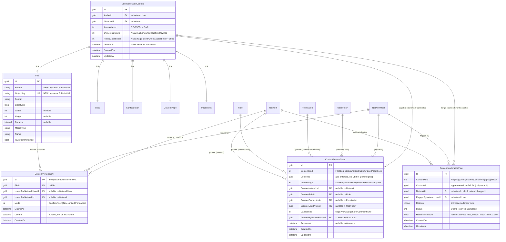

# PLAN — Unified User-Generated-Content Access Control & File Delivery

Implementation plan for the system sketched in `TPN_Files_Suggestion.md`, grounded in the
current schema/auth code described in `DATABASE_AND_AUTH_OVERVIEW.md` and the storage
architecture proposed in `FILE_SERVICE_SETUP.md`. `TPN_Files_Suggestion.md` is treated as
the product brief; this document answers its open questions and turns them into a build
plan.

---

## 0. Decisions, up front

### 0.1 MinIO: same compose as TPN, but *not* the separate Python file-service

`TPN_Files_Suggestion.md` asks whether to put MinIO in the TPN compose (for tight auth
coupling) or keep the `file-service` split described in `FILE_SERVICE_SETUP.md`.

**Recommendation: run MinIO alongside TPN (new `docker-compose.yml` in this repo), and
drop the separate Python `file-service`'s authorization model for TPN content.**

Reasoning:
- "Tight coupling" is a *code* property, not a *deployment-topology* property. TPN gets
  it by being the only process that ever holds MinIO's admin credentials and mints
  presigned URLs — exactly the seam that already exists for Cloudinary
  (`ICDNService`/`CloudinaryService`). Which compose file MinIO's container definition
  lives in doesn't change that.
- `FILE_SERVICE_SETUP.md`'s `file-service` has its **own** authorization model
  (`ServiceIdentity` + `file_grant` rows keyed on `service`/`user uuid`). Running that
  *and* TPN's `AccessLevel`/RBAC/consent-scope system for the same files means two
  authorization systems that must independently agree — precisely the "two code paths
  supposed to agree with each other" failure mode `DATABASE_AND_AUTH_OVERVIEW.md` §5/§6.8
  already flags for `AccessLevelVerifier` vs. `GetAccessPredicateAsync`. Don't add a
  third.
- So: MinIO becomes a peer container to TPN, on an internal-only Docker network. TPN's
  backend talks to the MinIO S3 API directly (new `MinioService : ICDNService`, same
  seam `CloudinaryService` uses today). `files.<domain>` is routed by nginx to **TPN**,
  never straight to MinIO (per the suggestion doc's own idea — see §4 below) — this also
  reads directly from `TPN_Files_Suggestion.md`: *"In nginx I think we could just
  redirect files.example.com/ to api.example.com/cdn/someHash so we can keep all the
  auth logic inside a single repository."* Confirmed — that's the design.
- `FILE_SERVICE_SETUP.md`'s good ideas are still worth keeping: two MinIO clients
  (internal vs. external hostname, to avoid the presign/`Host`-header mismatch), public
  vs. private buckets, "the API never proxies bytes" (redirect to a presigned URL
  instead), soft-delete + periodic hard-delete sweep, and the eventual `worker` service
  for transcodes/thumbnails. These get adopted *inside* TPN's file subsystem rather than
  as a separate repo. `FILE_SERVICE_SETUP.md` should be marked superseded once this
  ships (§9).

### 0.2 Answers to the numbered questions in `TPN_Files_Suggestion.md`

**Q1 — pasting a CDN URL in the browser doesn't send the bearer token.**
Don't try to make the browser send a bearer token to a plain URL. Instead make the *URL
itself* the credential: an unguessable, single-use (or short-lived), opaque token minted
per-request by TPN (`ContentViewingLink`, §2.3). No `Authorization` header is needed to
resolve it, so pasting/forwarding/embedding the link works exactly as expected, and
access is still fully gated because the token is minted only after TPN re-checks the
current access rules for the caller who requested it.

**Q2 — should `ManageFiles`-style permissions let moderators edit content, and should
content be author- or network-owned?**
Yes to the moderation-not-editing instinct — implemented as a real split, not a
convention: content stays editable only by its author (or, for network-owned content,
network admins), moderators get a `Moderate<Type>` permission that can only flag/hide,
never mutate (§2.4, `ContentModerationFlag`). Add an explicit `OwnershipMode`
(`AuthorOwned` default / `NetworkOwned`) to `UserContentBaseModel` (§2.1) so a network can
require content created through it to stay network-controlled (shareable to the creator
to edit, revocable by the network) instead of being portable-by-default like today's
model. This also finally gives a use for `IdentityVerifier.IsContentOwnerAsync`, which
already exists as a signature in the codebase but throws `NotImplementedException` —
implement it as part of this work (§3.2).

**Q3 — efficient access filtering over large lists.**
Keep the existing `AccessLevel` enum as the fast path (`Public`/`PublicToNetwork` need no
join at all — it's already like this today and stays that way). Layer fine-grained
sharing on top as a genuinely indexed table (`ContentAccessGrant`, §2.2) and combine the
two with `OR` in a single predicate, so the grant table is only ever touched for the
`Private`-but-shared minority of rows: `AccessLevel-allows OR EXISTS(...ContentAccessGrant WHERE ContentKind=@k AND ContentId=@id AND RevokedAt IS NULL AND (grantee matches))`. This mirrors the exact shape hinted in the suggestion doc (`UserFileAccesses`/
`NetworkFileAccesses`) but generalized to one polymorphic table instead of N per-type join
tables, with covering indexes on `(ContentKind, ContentId)` and
`(GranteeUserProxyId, ContentKind)`/`(GranteeNetworkId, ContentKind)` filtered on
`RevokedAt IS NULL`. `EXISTS` (semi-join), not `JOIN + DISTINCT` — keeps Postgres from
fanning out rows per grant when only presence matters.

---

## 1. Scope: generalize beyond files

Per the suggestion doc's "Not only to files" section, the access model must apply to
**every** `UserContentBaseModel` type — `File`, `Blog`, `Configuration`, `CustomPage`,
`PageBlock` — not just files. All new tables are keyed by a `ContentKind` discriminator
(`File | Blog | Configuration | CustomPage | PageBlock`) + `ContentId`, the same
un-constrained-FK pattern the codebase already uses for `PageBlock.ParentPageId`, so one
`ContentAccessGrant`/`ContentModerationFlag` table serves all five types instead of five
near-identical join tables.

---

## 2. Data model — new & revised tables

### ERD



`UserGeneratedContent` above is `UserContentBaseModel` — it isn't its own EF-mapped table
today (its columns are flattened into `File`/`Blog`/`Configuration`/`CustomPage`/
`PageBlock` individually, no discriminator column), so every "revised" column on it means
**one migration touching all five tables identically**.

### 2.1 `UserContentBaseModel` — revised (affects `File`, `Blog`, `Configuration`, `CustomPage`, `PageBlock`)

- `AccessLevel` gains `Draft` (append as a new int value, e.g. `Draft = 3` — do **not**
  renumber `Public`/`PublicToNetwork`/`Private`, they're persisted as ints today).
  `Draft` behaves like `Private` for everyone except the author, but is excluded from
  "recently published" style listings — enforced the same place `PublishedAt` is today
  (currently display-only; this finally gives blogs and other UGC a real draft state).
- `OwnershipMode` (new enum: `AuthorOwned = 0` default, `NetworkOwned = 1`). Governs who
  may manage sharing/grants (§2.4) and who `IsContentOwner` resolves to.
- `PublicCapabilities` (new flags enum, default `View | Share`). Only consulted when
  `AccessLevel == Public` — answers "Public (anyone can share and use)" from the
  suggestion doc without needing a `ContentAccessGrant` row for "the whole world".
- `DeletedAt` (new, nullable `DateTime`). Soft delete, generalized to all five content
  types (today only `File` deletes anything, and it's a hard delete). `File` deletion
  additionally purges the CDN object only once the row is hard-deleted by the cleanup
  sweep (§2.3), not on soft delete — matches "File state can be: Soft deleted" from the
  suggestion doc.
- `UserContentBaseRepository<T>`'s base query gets a `WHERE DeletedAt IS NULL` default;
  add `SoftDeleteAsync`/`RestoreAsync`.

### 2.2 `File` — revised

Drop Cloudinary's `PublicId`/`Url` pair; replace with `Bucket` + `ObjectKey` (unique),
matching the MinIO model in `FILE_SERVICE_SETUP.md`. No `Url` column anywhere — URLs are
never stored (`FILE_SERVICE_SETUP.md`'s house rule #5, and a precondition for one-time
links: a stored stable URL would defeat the point). `Format`, `SizeBytes`, `Width`,
`Height`, `Duration`, `MediaType`, `Name`, `IsSystemProtected` are unchanged.

### 2.3 `ContentViewingLink` — new

The one-time/short-lived link broker behind Q1 and the suggestion doc's "Notes" section.
`Id` is the opaque token used in the public URL. Flow:

```
files.<domain>/{token}
  → nginx → api.<domain>/cdn/{token}                      (TPN, no auth header needed)
  → look up ContentViewingLink by Id
      not found / expired / (Mode=OneTimeView and UsedAt != null)  → 404
  → re-check the file's *current* AccessLevel/ContentAccessGrant for
    IssuedForNetworkUserId (defense in depth: access may have been revoked
    after the link was minted but before it was used)
  → mark UsedAt (if Mode=OneTimeView)
  → 302 to a freshly presigned MinIO URL (short expiry; a NEW MinIO signature every
    time, per the doc's "don't use the same link" note — the ContentViewingLink token
    and the MinIO presigned URL it redirects to are two different, both single-use-ish,
    layers)
```

- `Mode = Permanent` is used only for `AccessLevel = Public` files: no per-request row at
  all, TPN returns a stable derived URL straight at MinIO's public bucket (anonymous GET
  enabled there, same as `FILE_SERVICE_SETUP.md` §4.3) — "if the image is set to public,
  I guess we can set a permanent viewing link" is handled by *not* going through this
  table for the public case.
- `Mode = OneTimeView` is the default for `Private`/shared files: minted fresh every time
  a `File`'s metadata is fetched or a `File` is resolved by id from embedded content
  (blog body, custom page block), so a stale/replayed link never re-renders.
- `Mode = TimeLimited` covers streaming (video/audio): a longer expiry, reusable within
  the window (matches `FILE_SERVICE_SETUP.md` §4.4's `PRESIGN_EXPIRY_STREAMING_SECONDS`
  reasoning — a single-render rule doesn't work for seekable media).
- Persisted in Postgres, not an in-process store — `DATABASE_AND_AUTH_OVERVIEW.md` §6.4
  already flags `AuthorizationCodeStore`'s in-memory-only design as a landmine for
  horizontal scaling; don't repeat that mistake for a second auth-adjacent store.
- Cleanup: a background sweep (hosted service) deletes rows where `ExpiresAt < now()`
  (mirrors the periodic hard-delete sweep already planned for soft-deleted files in
  `FILE_SERVICE_SETUP.md` §4.5).

### 2.4 `ContentAccessGrant` — new

Implements the suggestion doc's "Manage access" section generically:

- `GranteeType = Network` — share with every member of a network (`GranteeNetworkId`
  set). This is also how "share with an outside source" works: a third-party site is
  already modeled as a `Network` in this schema, so "share with network" *is* "share with
  an outside source" — no separate table needed.
- `GranteeType = NetworkRole` — share with members holding a specific `Role` in a
  specific network (`GranteeNetworkId` + `GranteeRoleId`).
- `GranteeType = NetworkPermission` — share with members holding a specific `Permission`
  in a specific network (`GranteeNetworkId` + `GranteePermissionId`).
- `GranteeType = User` — share with one person's persona directly (`GranteeUserProxyId`),
  independent of network — this is the Q1 "user 1 shares file A with user 2" case; keyed
  to `UserProxy` (persona), not `User`, consistent with how the rest of the schema treats
  a `UserProxy` as the addressable identity unit.
- `Capabilities` is a flags enum: `View | Edit | Share | Comment | Like` (`Comment`/`Like`
  reserved, not enforced yet — see §8 out of scope). `Share` = "user can re-share/repost
  this content, same underlying resource" per the doc's clarification that share/repost
  doesn't fork content.
- `RevokedAt` is a soft revoke (audit trail of who had access and when it was pulled),
  rather than deleting the row — directly answers the moderation worry in Q2 about
  content silently vanishing when a network revokes access ("would make moderating
  annoying"): the row (and its history) still exists, it's just no longer active.
- Managing grants on a piece of content requires `IsContentOwner` (author, or a network
  admin when `OwnershipMode = NetworkOwned`) **or** the new `ManageContentAccess`
  permission — not the existing `Manage<Type>` permissions, which per Q2 stay
  edit/delete-only and author-scoped going forward (§4).

### 2.5 `ContentModerationFlag` — new

Implements the Q2 conclusion: moderators flag/hide, they don't edit.

- One row per (network, content) moderation action. `HiddenInNetwork` suppresses the
  content only within that network's own views/lists — it does not touch the content's
  global `AccessLevel`, so a network can hide something it disagrees with without
  affecting the author or any other network the content is shared with.
- `Reason` is the arbitrary note from the doc ("Please remove x from this blog").
- `Status` tracks the flag's lifecycle (`Open`/`Resolved`/`Dismissed`) for a moderation
  queue UI.
- Read-path integration: the list/detail predicates (`AccessLevelVerifier`) additionally
  exclude content with an active `HiddenInNetwork` flag *for the network the request is
  scoped to* — same `EXISTS`-based shape as `ContentAccessGrant` (§0.2/Q3), same indexes.

---

## 3. Authorization plumbing changes

### 3.1 Must-fix-alongside (not new work, but this plan builds directly on top of it)

Two existing bugs sit squarely under the code this plan extends, and building fine-grained
sharing on top of a known-broken content-permission switch would just spread the bug to
more content types:

- **Blog single-item `AccessLevel` bypass** (`DATABASE_AND_AUTH_OVERVIEW.md` §5.2/§6.1):
  `PermissionHandler.HandleContentRequirementAsync`'s route-param lookup never matches
  for `ReadBlog` (`"slug"` vs. the actual `blogId`/`slug` route values), so single-blog
  reads skip `AccessLevelVerifier` entirely. Fix the route-param matching before adding
  `ContentAccessGrant`/`ContentModerationFlag` checks to the same switch, otherwise the
  new checks inherit the same silent bypass.
- **`IdentityVerifier.IsUserOwnerAsync` / `IsUserProxyOwnerAsync` don't filter by caller**
  (§6.2): unrelated on the surface, but this plan adds a *third* owner-style check
  (`IsContentOwnerAsync`) to the same class. Fix the existing two alongside so
  `IdentityVerifier` isn't shipped with two known-broken siblings next to a new one.

### 3.2 `IdentityVerifier.IsContentOwnerAsync` — implement the existing stub

Signature already exists, currently `throw new NotImplementedException()`. Implement as:
resolve the content's `AuthorId`/`OwnershipMode`; if `AuthorOwned`, owner = the caller's
`NetworkUser` row for that content's `AuthorId` (via `UserProxy` ownership, same pattern
as `IsNetworkUserOwnerAsync`, which is already correct); if `NetworkOwned`, owner = any
`NetworkUser` holding `Administrator` in `NetworkId`. Add `IsContentOwner` to
`Constants.OwnerPermissions`.

### 3.3 `AccessLevelVerifier` — extend, don't fork

`CheckAccessAsync` and `GetAccessPredicateAsync` both grow one more `OR` branch:
`ContentAccessGrant` (capability-matching, `RevokedAt IS NULL`, not expired) and a `NOT
EXISTS` branch for `ContentModerationFlag.HiddenInNetwork` scoped to the request's
network. Keep the single-item and list-predicate versions in the same file, updated
together, same as today — the duplication risk already flagged in §6.8 is a reason to be
careful editing both, not a reason to introduce a third code path.

### 3.4 New `Constants.Permissions`

```
ManageContentAccess   = "Manage Content Access"   // grant/revoke sharing (OR'd with IsContentOwner)
ModerateFile          = "Moderate File"
ModerateBlog          = "Moderate Blog"
ModerateConfiguration = "Moderate Configuration"
ModerateCustomPage    = "Moderate CustomPage"
ModeratePageBlock     = "Moderate PageBlock"
```

`Moderate*` go through the existing default role-based path (network-scoped, like
`Manage*` today) — no new grouping array needed structurally, they're just new named
permissions seeded per network the same way `Manage*` is today.

---

## 4. Behavior change to flag explicitly (needs sign-off, not silently shipped)

Today, `Manage<Type>` lets **any** role-holder edit or delete **any other member's**
content in the network, including private drafts (§5.5 in the overview doc) — "reasonable
for a CMS-editor model" as originally written, but it directly contradicts the Q2
conclusion that moderators shouldn't edit others' content. This plan narrows `Manage*` to:
author-only for `AuthorOwned` content, author-or-admin for `NetworkOwned` content; genuine
network-wide moderation moves to the new `Moderate*` permissions (flag/hide only). Existing
callers relying on "any editor role can fix any post" lose that ability and must switch to
`OwnershipMode = NetworkOwned` if they want admins to retain edit rights.

---

## 5. File delivery / infra changes

- New `docker-compose.yml` in this repo: `tpn` service + `minio` service, internal Docker
  network, no host ports published for MinIO (admin console reachable only via a
  temporary port-forward if needed, per `FILE_SERVICE_SETUP.md`'s convention).
- New `MinioOptions` (`Core/Helper/`) bound from env: root user/password, internal
  endpoint (`minio:9000`), external endpoint (`cdn.<domain>`), presign expiries. Same
  fail-fast-on-missing-env style as `CloudinaryOptions`.
- New `MinioService : ICDNService` (`Application/Services/UserContent/`) replacing
  `CloudinaryService` in DI — **two** MinIO clients (internal + external hostname), per
  `FILE_SERVICE_SETUP.md`'s documented presign/`Host`-header gotcha.
- One-time bucket bootstrap (`public`, `private`) with anonymous `GET` enabled only on
  `public` — either a startup hook in `Program.cs` (consistent with this repo's existing
  "migrate + seed on startup" pattern) or a compose one-shot job.
- nginx (gateway repo, outside this codebase — document the required rule here):
  `files.<domain>` → `api.<domain>/cdn/{token}`; `cdn.<domain>` → `minio:9000` directly
  for the actual presigned byte transfer (TPN never proxies bytes, only mints the
  redirect — same principle as `FILE_SERVICE_SETUP.md` §2.4/§4.2).
- `GET /cdn/{token}` is a new, deliberately unauthenticated endpoint (no
  `[RequirePermission]`, no bearer token expected) — the token itself is the credential
  (§2.3).

---

## 6. New/changed API surface

- `File`/`Blog`/`Configuration`/`CustomPage`/`PageBlock` controllers each get:
  - `GET/POST/DELETE .../{id}/access` — list/grant/revoke `ContentAccessGrant`s,
    `[RequirePermission(ManageContentAccess, IsContentOwner)]`. One shared
    `ContentAccessGrantService` (parameterized by `ContentKind`) backs all five thin
    controller methods, mirroring the existing `UserContentBaseService<T>` pattern.
  - `POST/GET .../{id}/moderation-flags`, `PUT .../{id}/moderation-flags/{flagId}/resolve`
    — `[RequirePermission(Moderate<Type>)]`.
- `File` metadata responses drop any stored `Url` field; the DTO instead carries a
  `ViewingUrl` computed fresh per request (mints a `ContentViewingLink` server-side for
  non-public files, or a stable public URL for `AccessLevel = Public` files).
- `GET /cdn/{token}` — public, anonymous, 302 redirect (§5).

---

## 7. Suggested implementation order

1. **Fix-alongside bugs** (§3.1) — Blog single-item bypass, `IsUserOwnerAsync`/
   `IsUserProxyOwnerAsync` caller-filtering. Small, isolated, unblocks everything else.
2. **Storage swap** — MinIO container + `MinioService : ICDNService`, `File.Bucket`/
   `ObjectKey` migration, one-off re-upload of existing Cloudinary assets into MinIO.
3. **`UserContentBaseModel` revisions** — `Draft`, `OwnershipMode`, `PublicCapabilities`,
   `DeletedAt`; one migration across all five content tables; repository base-query
   filtering + soft-delete methods.
4. **`ContentAccessGrant`** — model/migration/repository/service, `IsContentOwnerAsync`
   implementation, `AccessLevelVerifier` extension, grant CRUD endpoints.
5. **`ContentViewingLink`** — model/migration/repository/service, `GET /cdn/{token}`,
   `ViewingUrl` computation on read paths, expiry cleanup sweep.
6. **`ContentModerationFlag`** — model/migration/repository/service, `Moderate<Type>`
   permissions, flag/hide read-path integration, narrowed `Manage<Type>` semantics (§4 —
   confirm sign-off before shipping this part).
7. **Docs** — update `DATABASE_AND_AUTH_OVERVIEW.md`'s domain-model section for the new
   tables/flows; mark `FILE_SERVICE_SETUP.md` superseded, pointing here.

---

## 8. Explicitly out of scope for this pass

- Enforcing `Comment`/`Like` capabilities (columns/flags exist for forward-compatibility
  only, per the doc's own "scope for the future maybe").
- The `worker` transcode/thumbnail service from `FILE_SERVICE_SETUP.md`'s roadmap —
  same idea, revisited once the storage swap (step 2) has landed.
- Multi-instance horizontal scaling hardening beyond "don't use in-memory stores for new
  work" (§2.3) — `JtiCacheService`/`AuthorizationCodeStore`'s existing process-local
  state is a separate, pre-existing issue (§6.4 in the overview doc), not introduced or
  fixed by this plan.

## 9. Open risk to flag back to product

`FILE_SERVICE_SETUP.md` describes a real, partially-designed alternative architecture
(separate repo, separate Postgres database, service-token auth). This plan recommends not
building that for TPN-owned content and instead folding MinIO into TPN directly. If that
Python service is already in use elsewhere (e.g., a non-TPN homelab service), keep it
running for those callers — just don't route TPN's `File`/UGC content through it, to avoid
the dual-authorization-system problem in §0.1.
